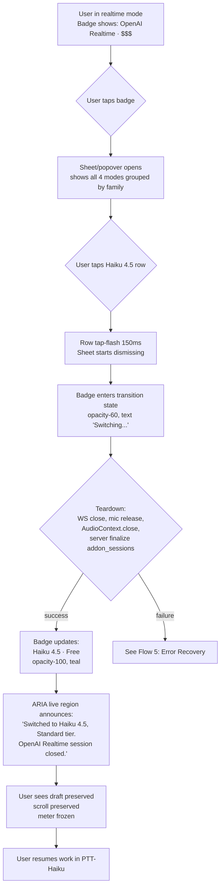
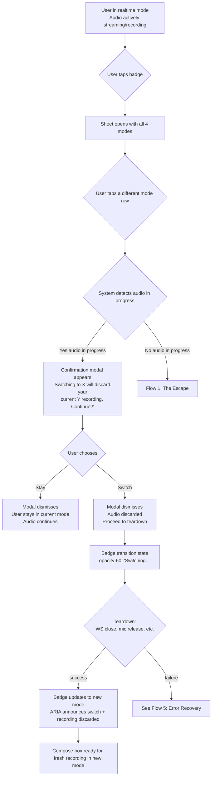
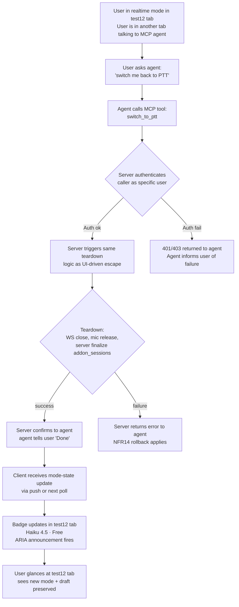

---
stepsCompleted:
  - step-01-init
  - step-02-discovery
  - step-03-core-experience
  - step-04-emotional-response
  - step-05-inspiration
  - step-06-design-system
  - step-07-defining-experience
  - step-08-visual-foundation
  - step-09-design-directions
  - step-10-user-journeys
  - step-11-component-strategy
  - step-12-ux-patterns
  - step-13-responsive-accessibility
  - step-14-complete
lastStep: 14
inputDocuments:
  - path: '_bmad-output/planning-artifacts/prd.md'
    type: 'prd'
    note: 'Primary input — defines 31 FRs and 19 NFRs for the voice-mode switcher. Implied UI: collapsed badge, expanded switcher, mid-flight confirmation modal, mobile bottom-sheet variant, teardown-in-progress state, plus keyboard/screen-reader/reduced-motion requirements.'
  - path: '_bmad-output/planning-artifacts/implementation-readiness-report-2026-05-27.md'
    type: 'readiness-report'
    note: 'Companion context — flagged the open mid-flight transition policy decision (discard-with-confirm vs finish-then-switch vs queue-and-resume) as a UX-owned question, and the unverified header-chrome a11y baseline as a UX/QA audit item.'
  - path: 'README.md'
    type: 'project-context'
    note: 'Existing test12 app overview. PARTIALLY STALE on tech stack — see PRD frontmatter inputDocuments note for details. Useful for design tone and existing visual language.'
workflowType: 'ux-design'
project_name: 'test12'
author: 'BMad'
date: '2026-05-27'
mode: 'create'
focus: 'voice-mode-switcher'
---

# UX Design Specification — test12

**Author:** BMad
**Date:** 2026-05-27
**Focus:** Voice-Mode Switcher (the cost-trap escape feature scoped in `prd.md`)

---

<!-- UX design content will be appended sequentially through collaborative workflow steps -->

## Executive Summary

### Project Vision

A voice-first PWA where the user, not the vendor, controls which AI voice
mode handles their next utterance. Four modes are available today — two
PTT modes (Haiku 4.5 free, Sonnet 4.6 paid) and two realtime modes
(xAI Grok paid, OpenAI Realtime paid). The UX deliverable is a **global
mode switcher** that lets users see their current mode and its cost tier
at all times, switch between modes in one tap without page refresh,
preserve their in-flight state across the switch, and never get trapped
in a paid mode they didn't intend to enter. The hero moment is *the
escape* — a user in OpenAI Realtime tapping back to Haiku, landing on
free PTT with their draft and scroll intact.

### Target Users

**Primary — Maria (the design's reference user):** mobile-first PWA
user, non-anglophone, taps into a realtime mode out of curiosity, hits
the trap, needs a one-tap escape with no cognitive load. Design works
if it works for her.

**Primary — David:** power user deliberately A/B-testing modes across
families. Hops between PTT-Sonnet, xAI Realtime, and Haiku in a single
session. Needs the switcher to feel fast and familiar — a feature, not
a chore.

**Indirect — Sofia:** voice-assistant user who switches via MCP, never
touching the UI directly. The UI exists for her as the *visible
manifestation* of a contract the agent invokes on her behalf.

**Indirect — BMad (operator):** uses analytics, not the control. UI
success for him means seeing high discovery, frequent use, and zero
support tickets in the bake-off telemetry.

### Key Design Challenges

1. **Asymmetric familiarity.** The control is new; users already know
   Connect / Disconnect. The switcher must announce itself without
   feeling like clutter against the existing header chrome.
2. **Four modes is borderline.** Grouping by family (PTT / Realtime)
   makes interaction-pattern differences legible, but the grouping
   itself can't become cognitive overhead.
3. **Cost transparency without cost anxiety.** Badge must signal "this
   costs money" clearly enough that Maria doesn't fall in by accident,
   but not so prominently that users avoid paid modes entirely (which
   would kill the bake-off signal).
4. **Mid-flight transition policy is undecided.** Discard-with-confirm,
   finish-then-switch, queue-and-resume — to be decided in this
   workflow.
5. **Mobile-first portrait constraint.** Existing header already carries
   login/profile/logout/PWA-install. Switcher must fit without crowding
   the title or existing actions, and remain reachable with a thumb.
6. **Teardown-in-progress state has no precedent in existing UI.** The
   ≤500 ms gap between "user taps escape" and "new mode active" needs a
   defined visual treatment so it doesn't feel like a stutter.

### Design Opportunities

1. **Badge-as-status-as-control pattern.** Single header element does
   double duty — at-a-glance current mode + cost-tier indicator, and
   the entry point for switching. Minimal screen footprint, maximum
   meaning.
2. **Cost-tier visual continuity with `addon-usage-bars`.** Reuse the
   existing `aub-fill.ok` (teal) / `.warn` (amber) / `.full` (red)
   tokens for Free / $$ / $$$ badge variants. Semantic + visual
   continuity: users who learn one learn both.
3. **Family grouping as cognitive scaffolding.** Naming "PTT family"
   and "Realtime family" in the switcher teaches the
   interaction-pattern difference (tap-and-talk vs persistent stream),
   so users predict behavior before tapping.
4. **Mid-flight modal as trust contract.** A confirmation prompt that
   asks before it discards work isn't friction — it's the moment the
   product *earns* the right to be trusted with paid sessions.
5. **PWA-installed = iOS-settings-sheet feel.** Portrait-locked
   standalone display dominates per `manifest.json`. A bottom-sheet
   switcher with iOS-native gesture feel will land as "right at home"
   rather than "another web control."

## Core User Experience

### Defining Experience

For the mode switcher, the user does **one thing, sometimes two**:

1. **Glance** at the badge in the header. (Always.) Knows what mode they're in
   and what it costs. Decides whether to keep going or switch. ~80% of
   interactions stop here.
2. **Tap** the badge, open the switcher, pick a different mode. (Sometimes.)
   ~20% of interactions go this far. Of those, the dominant pattern is
   "tap from a paid realtime mode back to free PTT" — *the escape*.

Everything else (the mid-flight modal, the teardown-in-progress state,
the keyboard flow, the screen-reader announcement) is in service of those
two moves. If glance-and-decide is effortless and tap-to-escape is
flawless, the feature succeeds. If either feels wrong, the trust
contract breaks.

### Platform Strategy

**Mobile-first PWA, portrait-locked, installed on iOS home screen** is the
dominant context per `public/manifest.json` (`display: standalone`,
`orientation: portrait-primary`, full iOS-tuned meta tags and apple-touch
icons). Design decisions follow this hierarchy:

- **Mobile portrait (the design target):** thumb-reachable, bottom-sheet
  expansion, iOS-native gesture language. The switcher must work for a
  user standing on a subway with one hand on the phone.
- **Mobile landscape:** acceptable but not the target. Existing layout
  already constrains this via portrait-locked manifest.
- **Desktop (≥768 px):** same component, expanded inline. Mouse + keyboard.
  Secondary use case but must not be neglected — power users like David
  test on desktop too.
- **PWA-installed mode:** indistinguishable from a native app's settings
  sheet. The browser chrome is gone; our chrome carries the whole UI.

Touch is primary. Hover states are progressive enhancement (desktop only).
Keyboard nav is mandatory (FR29) but not the primary interaction model.
No offline-specific behavior needed beyond the existing service-worker
cached shell (NFR15 covers the version-skew edge case).

### Effortless Interactions

Five things should feel completely natural — zero thought required:

1. **Knowing what mode you're in.** Always. The badge in the header is
   *constantly* visible. No menu, no settings page, no preferences. If
   the user can see the page, they can see their mode.
2. **Knowing what it costs.** The cost-tier badge (Free / $$ / $$$) sits
   right next to the mode name, in colors that match the existing
   `aub-fill` palette users have already learned from the addon-usage
   bars. They've seen the language before.
3. **Escaping a paid mode.** One tap on the badge, one tap on "Haiku 4.5
   (Free)" at the top of the PTT family in the switcher list. Two taps,
   under 1 second, no surprises.
4. **Voice-command mode switching in PTT.** Already exists; must remain
   effortless. Saying "switch to xAI" while in PTT mode continues to
   work exactly as it does today — the new UI is *additive*, not
   replacement.
5. **Continuing what you were doing.** After any switch, the draft is
   still there. The scroll is where it was. The conversational step
   (mid-reply, mid-confirmation) is preserved. The user picks up exactly
   where they left off.

### Critical Success Moments

The moments that determine whether the feature delivers or fails:

1. **First-time discovery — the badge catches the eye.** A user who
   doesn't know the switcher exists notices it within the first 1-2
   sessions, because the badge sits in the header right next to the
   Profile button. If users don't discover it organically before getting
   trapped, the feature is invisible.
2. **The escape itself.** A user trapped in OpenAI Realtime taps the
   badge → taps "Haiku 4.5 (Free)" → in under 500 ms the badge updates to
   Free, the meter freezes, the draft is intact. *"I'm not trapped."*
   This is the feature. If this is anything less than instant and
   flawless, the entire trust contract collapses.
3. **The mid-flight ask.** A user switches mid-recording. The modal
   appears: *"Switching to Sonnet 4.6 will discard your current xAI
   Realtime recording. Continue?"* User taps Switch. Recording
   discarded, new mode active, no surprise. If the modal feels
   bureaucratic, it's friction; if it feels protective, it's a deposit
   in the trust bank.
4. **The teardown moment.** ≤500 ms of "switching..." — long enough that
   it must be acknowledged visually, short enough that it must not feel
   like waiting. The badge shows an interim state, the previous mode's
   indicators (mic indicator, orb animation) wind down, the new mode's
   indicators come up. No spinner. No "loading…" text. The transition
   *is* the indicator.
5. **The return to free.** After the escape, the badge shows Free and
   the user does whatever they were going to do — post, reply, navigate
   away — in a mode that costs them nothing. This is the moment they
   internalize "I can experiment safely." Without it, users won't try
   paid modes again, killing bake-off signal.

### Experience Principles

These six principles govern every design decision downstream:

1. **The escape is sacred.** Always reachable. Always one tap. Never
   blocked by a modal, animation, or load state. The escape is the
   product's promise.
2. **Status is always visible, never hidden.** The badge sits in chrome
   at all times in the authenticated app. It is never collapsed into a
   hamburger menu, never tucked into a settings page, never gated
   behind a "show advanced" toggle.
3. **Cost is transparent, not threatening.** Signal clearly enough that
   accidents are rare; signal lightly enough that paid modes still feel
   inviting to try. The bake-off depends on users sampling the paid
   modes; over-warning them breaks the data.
4. **Honor the existing voice-first behavior.** Voice-command mode
   switching in PTT (today's `dispatchIntent` regex match) continues
   to work unchanged. The visual UI is additive, never replacement. A
   user who learned the voice command must not have to learn a new tap
   sequence.
5. **PWA-native, not web-translated-to-mobile.** Bottom sheets, snap
   stops, large tap targets, thumb-reach paths. The switcher should
   feel like an iOS settings sheet, not a desktop dropdown shoved into
   a phone viewport.
6. **Asking is not friction; asking is trust.** The mid-flight
   confirmation modal is not a barrier — it's the moment the product
   *earns* the right to handle paid sessions. Every confirmation,
   announcement, and "are you sure" is a deposit in the trust bank, not
   a withdrawal from user patience.

## Desired Emotional Response

### Primary Emotional Goals

Three feelings define success for this feature, in priority order:

1. **Relief.** The dominant emotion at the hero moment — when a trapped
   user taps escape and lands back in free PTT with their work intact.
   *"Oh thank god, that worked."* This is the feeling the entire
   feature is engineered to produce. If users don't feel relief, the
   escape failed regardless of whether the bits flipped.
2. **Agency.** The continuous emotion — the persistent sense that
   *"I'm in control of what this product is doing on my behalf."* Not
   relief from a panic moment; the absence of panic in the first place.
   Maria should feel this every time she glances at the header and
   sees "Haiku 4.5 (Free)" — confirmation that she's in the mode she
   chose, costing what she expected.
3. **Trust.** The compound emotion that accumulates over time. Built
   from many small deposits: the mid-flight modal that asks before
   discarding work, the cost-tier badge that doesn't hide what things
   cost, the escape that always works in the time it promises.
   *"This product won't burn me silently."* This is the emotion that
   determines whether users try paid modes a second time.

The shorthand: **"I'm not trapped. I'm in control. I trust this app."**

### Emotional Journey Mapping

The mode switcher's emotional arc across the user's relationship with
the product:

**First encounter (session 1):** Mild curiosity. A user notices a small
badge in the header showing "Haiku 4.5 (Free)" and thinks *"huh,
what's that?"* The emotion is light — exploration, not pressure. If
the badge feels intriguing rather than ignorable, discovery succeeds.

**First paid-mode trial (deliberate):** Curiosity edged with caution.
The user taps the badge, sees the four modes grouped by family with
cost tiers visible, picks a paid one. The emotion at the moment of
selection is *"let me see what this is like"* — exploratory, not
committed. The visible cost tier ($$$ next to OpenAI Realtime) makes
the choice conscious without making it scary.

**Inside a paid mode:** Engagement with low-level cost awareness. The
badge in the header still shows the current mode; the addon-usage bars
at the bottom of the page still tick down. The user is using the
feature they paid for — emotion should be *engagement*, not *anxiety
about the meter*.

**The trap moment (accidental or regretted):** Sharp realization.
*"This isn't what I wanted. I'm spending money on something that
isn't working for me."* The emotion is friction — and the speed at
which the user finds the escape determines whether friction becomes
frustration or stays manageable.

**The escape:** Relief. The badge updates to Free in under half a
second. The meter freezes. The draft is still there. The user
exhales. *"OK, that wasn't a disaster."* If this transition is even
slightly clunky, the emotion shifts from relief to *"I dodged a
bullet,"* which is much worse for long-term trust.

**The return (re-trying a paid mode later):** Cautious confidence.
*"Last time I escaped fine. Let me try again."* This is the emotion
that drives the bake-off data — users only sample paid modes
repeatedly if the previous escape was clean.

**Error or failure modes:** Acknowledged, not hidden. If teardown
fails or a mode switch errors, the user feels *informed*, not
*betrayed*. The system says clearly *what* went wrong and offers a
clear next action. Anger comes from silence, not from problems.

**Long-term:** Settled trust. The badge becomes invisible in the way
that working software always becomes invisible — the user stops
noticing it because it's never a problem. *"This app respects me"*
is the steady-state emotional baseline.

### Micro-Emotions

The subtle feelings that determine whether the primary emotions land:

| Pursue | Avoid |
|---|---|
| **Trust** — built through transparency and "asking before destroying" | **Skepticism** — caused by hidden costs, silent state changes, surprise outcomes |
| **Confidence** — every interaction does what the user expected | **Confusion** — about what mode is active, what it costs, how to switch |
| **Calm** — instant feedback, smooth transitions, no surprises | **Anxiety** — about getting trapped, accidental spending, lost work |
| **Accomplishment** — the user got what they wanted, in the mode they chose | **Frustration** — about lost drafts, dropped scroll, broken voice flows |
| **Acknowledgment** — the system *sees* what the user is doing and asks before destroying it | **Isolation** — the system silently discards work without consultation |
| **Composure** — the user can experiment freely because the cost of mistakes is zero | **Shame** — for accidentally tapping a paid mode |

### Design Implications

How emotional goals translate into specific UX decisions:

| Emotion | Design choice |
|---|---|
| **Relief at escape** | Sub-500 ms transition. No spinner. No "loading…" text. The visual change *is* the confirmation. The mic indicator winds down smoothly, the orb stops pulsing, the badge updates color. Done. |
| **Continuous agency** | Badge in chrome at all times. Never collapsed, never hidden behind a menu, never gated. Always one tap from the switcher list. |
| **Compound trust** | Mid-flight modal that asks before destroying work. ARIA live-region announcements that confirm what just happened. Telemetry that lets us prove zero phantom billing. Each is a small ritual that earns confidence. |
| **Calm cost awareness** | Cost-tier badge uses the existing `aub-fill` palette tokens — teal for Free, amber for $$, red for $$$. These colors are *informational*, not alarming. The badge is the size of a small chip, not a banner. |
| **Cautious confidence in re-entry** | After a successful escape, the user lands in PTT-Haiku with all state intact and *no nag about being more careful*. The system doesn't shame; it just works. |
| **Acknowledgment over isolation** | When discarding user audio mid-recording, the modal copy explicitly names what will be lost: *"Switching to Sonnet 4.6 will discard your current xAI Realtime recording."* No euphemism. No "Are you sure?" — that wastes the asking moment. The ask itself *is* the trust deposit. |
| **No shame at accidental paid taps** | If a user enters and immediately exits a paid mode (within ~5 seconds and no audio recorded), telemetry logs it but the UI shows no special "are you sure" treatment. Users should feel *free to explore* — accidental taps are part of learning, not a moral failing. |
| **Error states feel informed, not betrayed** | When teardown fails (network drop mid-exit), the UI shows: *"Switch failed. You're still in OpenAI Realtime. Try again or refresh."* No silence. No spinner of death. The user knows the state and the options. |

### Emotional Design Principles

Four principles to govern emotional design decisions downstream:

1. **Engineer for relief, not just for function.** The escape working is
   table stakes; the escape *feeling* like relief is the win. Time the
   transition, time the feedback, eliminate any micro-stutter that
   would replace relief with mild anxiety.
2. **Cost awareness is informational, never moral.** The badge informs.
   It does not warn, scold, or congratulate. Free is not "better than
   paid" visually; it's just "different from paid." Users should feel
   composed at every tier.
3. **Ask, then act — never the reverse.** The mid-flight modal asks
   before discarding. The teardown signal goes out before the UI
   commits. Asking is the most important emotional ritual the feature
   has.
4. **Silence is never neutral.** If something is happening (teardown,
   error, recovery), the user gets a visual sign. Silence reads as
   "the app is broken," not as "everything is fine." Even successful
   instantaneous actions get a confirmation (the badge color change is
   itself the confirmation; no extra UI needed).

## UX Pattern Analysis & Inspiration

### Inspiring Products Analysis

These four products were chosen because each solves a UX problem
directly analogous to one the mode switcher must solve. They are
references for the *pattern*, not for the *visual style* — test12 has
its own visual language (teal `#1595b2`, dark `#050810`, Inter,
existing `aub-fill` palette) that will not be displaced.

**1. iOS Control Center** — the gold standard for mobile glance-and-tap
controls.

- **What it does well:** Toggle controls grouped by function (audio,
  display, connectivity), bottom-sheet expansion from a single
  surface-level pill, instant visual feedback on tap, never more than
  one level deep. Color-coded by function (green = on, gray = off,
  blue = active) in a way that's informational and never alarming.
- **Why it matters here:** This is the gestural and structural
  reference for the expanded switcher on mobile. The PWA installed on
  iOS home screen *is* an iOS-context app from the user's perspective;
  matching this pattern means matching what users already know.

**2. Spotify / Apple Music playback bar** — the badge-as-status-as-control
pattern in its mature form.

- **What it does well:** A persistent bar at the bottom of the screen
  shows current state (track name, artist, play/pause). Tap to expand
  to full controls. The bar is *always visible* in the app's
  authenticated chrome — it never collapses, never hides behind a
  hamburger, never gets gated. One element doing two jobs: status and
  control.
- **Why it matters here:** This is the direct precedent for the
  mode-switcher badge. Same dual-purpose pattern: at-a-glance status
  (current mode + cost tier) + entry point for change (tap to switch).

**3. ChatGPT and Claude.ai model picker** — the direct analog for
mode/model selection within an AI chat app.

- **What it does well:** Visible model name in chrome (current
  selection always known), tap reveals model list with tier labels
  (free / Plus / Pro), grouped by capability tier, immediate switch
  on selection with no confirmation step for non-destructive
  switching. Cost tiers are *labeled*, not hidden.
- **Why it matters here:** This is the closest extant pattern to what
  we're building. test12's mode switcher essentially asks: *"how does
  ChatGPT's model picker work, but with the added constraint that some
  modes are billed-by-the-minute streams the user can get trapped in?"*
  Inherit the discoverability and the tier-labeling; add the escape
  contract on top.

**4. Zoom "Leave Meeting" button** — the gold standard for always-visible
escape from a paid/billed session.

- **What it does well:** The Leave button is *always* on screen during
  a meeting, in the same place, the same color (red). It's never
  buried behind a menu. Even when other UI minimizes, Leave remains.
  The mental model is *"this is a session I'm in, and I can always
  end it."*
- **Why it matters here:** The realtime modes are *sessions* in the
  same sense Zoom calls are — once entered, billing accumulates until
  exit. Zoom's design teaches users that *the exit is always reachable*.
  Our cost-tier badge in the header functions like the Leave button
  for realtime modes: always there, always one tap, never hidden.

### Transferable UX Patterns

Patterns to adopt or adapt from the analysis:

**Navigation Patterns**

- **Bottom-sheet expansion from a header pill** (iOS Control Center,
  Spotify mobile) — for the mobile expanded switcher. Snap stops,
  drag-to-dismiss, large tap targets, no nested navigation.
- **Persistent chrome with single dual-purpose element**
  (Spotify/Apple Music bar) — for the badge. The badge *is* the
  control; no separate "switch mode" button required.
- **Always-reachable escape during a billed session** (Zoom Leave
  Meeting) — for the realtime-mode UX. The badge stays visible even
  during a realtime WS session; it never collapses when the orb is
  active.

**Interaction Patterns**

- **Tier-labeled list selection** (ChatGPT/Claude.ai model picker) —
  for the expanded switcher. Each mode shows name + tier badge; tier
  is informational, not promotional.
- **Tap-to-switch with no confirmation for non-destructive changes**
  (model pickers) — for PTT↔PTT and Realtime↔Realtime transitions
  when no audio is in flight. The mid-flight confirmation modal is
  *only* for mode switches that would discard work.
- **Immediate visual feedback at tap** (iOS Control Center, model
  pickers) — for the badge. The badge updates color/label
  *immediately* on tap; the actual teardown completes in the
  background while the user sees the new state.

**Visual Patterns**

- **Color as informational tier marker, not warning**
  (iOS volume/brightness sliders, fitness HR zones) — for the
  cost-tier badge. Reuse `aub-fill.ok` (teal) / `.warn` (amber) /
  `.full` (red) tokens from `addon-usage-bars` for Free / $$ / $$$.
  These users have already learned the language.
- **Symbol redundancy alongside color** (iOS Control Center icons,
  Stripe payment-method badges) — for accessibility compliance
  (NFR18, FR9). Free uses no badge or "FREE" text; $$ and $$$ use
  literal dollar symbols.
- **Family grouping with subtle headers** (iOS Settings sections) —
  for "PTT" / "Realtime" family labels in the switcher list. Small
  uppercase labels above each group, not boxes or dividers, so the
  grouping is read as *organization*, not *segregation*.

### Anti-Patterns to Avoid

Direct learnings from products that get this wrong:

1. **Hiding mode switching behind a settings menu** — e.g., Discord
   "User Settings > Voice & Video > Input/Output Device." This buries
   the control multiple taps deep, breaks the "status is always
   visible" principle, and would be fatal for the trust contract.
2. **Tab-switching for modes** — treating each voice mode as a separate
   "view" or "page" the user navigates between. Loses the unified app
   context (compose box, channels, drafts), forces re-entry to the
   same data, multiplies state-preservation complexity.
3. **Modal-on-every-tap** — confirming *every* mode change (not just
   destructive ones) erodes the "asking is trust" deposit. Users
   become numb to dialogs and dismiss them reflexively, missing the
   actual important asks. Mid-flight modal ONLY when audio is in
   flight.
4. **Hover-only affordances** — desktop-web UX patterns that reveal
   controls on hover. Useless on touch (the design target) and a
   discoverability dead-end. The badge tells you it's tappable by
   *looking* like a button always, not by waiting for hover.
5. **Upsell styling for paid tiers** — *"⭐ Upgrade to Sonnet for
   smarter responses!"* with golden glow effects. Betrays "cost is
   informational, never moral." The badge labels paid tiers; it does
   not promote them.
6. **Surprise billing notifications** — modal pop-ups during a session
   like *"You've used 5 minutes — continue?"* These feel accusatory
   and break flow. test12 already has continuous usage bars at the
   bottom; that's enough. Don't interrupt to remind users they're
   paying.
7. **Spinner-of-death during teardown** — replacing the badge with a
   loading spinner during the ≤500 ms WebSocket close. Looks broken
   even when working. Better: the badge text/color is the
   "transition-in-progress" indicator (e.g., dimmed for ≤500 ms,
   then crisp at the new state).
8. **Forcing users to memorize codes or IDs** — e.g., displaying mode
   as `'deluxe-claude'` instead of "Sonnet 4.6 (Deluxe-Claude)". The
   `VA_MODE` enum is implementation; users see human labels.

### Design Inspiration Strategy

**What to adopt directly:**

- **iOS Control Center bottom-sheet pattern** for mobile expanded
  switcher — because it matches user mental models from their native
  OS context.
- **Spotify-style persistent chrome dual-purpose element** for the
  badge — because it solves status + control in a single screen
  element without taxing precious header real estate.
- **Zoom-style always-visible escape** for realtime mode UX — because
  it's the proven pattern for billed-session escape and directly
  serves the trust contract.

**What to adapt:**

- **ChatGPT/Claude model picker tier labeling** — simplified for our
  4-mode 2-family structure. Add the family grouping headers
  (PTT / Realtime) that the model pickers don't need but our 4-mode
  list benefits from.
- **iOS Control Center color language** — reuse intent (color = state,
  not warning) but with test12's existing `aub-fill` palette tokens
  instead of iOS system colors, for visual continuity with the
  addon-usage bars.
- **Mid-flight ask pattern** — borrowed from systems like Mac OS app
  quit confirmation ("Save changes? Don't Save / Cancel / Save"),
  adapted to name *exactly* what will be discarded ("Switching to
  Sonnet will discard your current xAI Realtime recording.").

**What to avoid:**

- Discord-style settings-buried mode controls — conflicts with
  "status is always visible."
- Upsell-style tier promotion — conflicts with "cost is
  informational, never moral."
- Surprise interruption modals — conflicts with the existing
  addon-usage-bars approach to passive cost awareness.

---

*Source caveat: these inspirations are drawn from general UX
knowledge of well-known apps, not from observed test12 user behavior.
If specific apps your users actually use would be a better reference
basis, name them and this section will be revised.*

## Design System Foundation

### Design System Choice

**Approach: Tailwind CSS, after a separate codebase-wide migration epic.**

This UX specification commits the mode switcher to **Tailwind CSS** as
its styling foundation. test12 does not currently use Tailwind — the
codebase is monolithic `public/index.html` with inline `<style>`-block
CSS — so this UX spec also commits to a **precursor migration epic**
that must ship before mode-switcher implementation begins.

This is a deliberate sequencing decision: rather than introduce
Tailwind locally for one feature (creating two parallel styling
systems in the same file for an undetermined transition period), the
project migrates everything first, then authors new work natively.
Cleaner end-state, higher up-front cost, lower long-term drag.

### Precursor: Tailwind Migration Epic

**Status: To be authored.** This must complete before mode-switcher
implementation can start. Scope summary (subject to detailed epic
authoring):

- **Add a proper PostCSS + Tailwind CLI build step.** Not the CDN
  variants — those are unfit for production per Tailwind's own
  guidance and would degrade NFR5 (TTI). The CLI build produces a
  purged, minified CSS file shipped alongside `index.html`.
- **Configure `tailwind.config.js`** to preserve existing brand
  tokens — teal `#1595b2`, dark `#050810`, the `aub-fill` palette
  (`#1595b2` / `#f59e0b` / `#ef4444`), Inter typography, the
  translucent-teal overlay scale — as `theme.extend` entries. Users
  must not perceive a visual change after the migration.
- **Migrate `public/index.html` page-by-page.** All ~9000 lines of
  HTML markup get class-name churn; ~1100 lines of `<style>`-block
  CSS get deleted as replaced. Migration is structured so each
  commit is independently shippable and visually verifiable.
- **Preserve PWA shell semantics.** Bump `CACHE_VERSION` exactly
  once at the end of migration. The service worker's network-first
  HTML policy means a single returning-user cache cliff, not many.
- **Verify no regression** in posting, threading, channels, auth,
  aliases, addon-usage-bars, the orb animation, `body::before`
  ambient background, iOS `-webkit-fill-available` viewport fix,
  PWA install banner. Each is a regression candidate.
- **Update deploy scripts** (`deploy.ps1`, `deploy-dev.ps1`) to
  invoke the Tailwind build step before bundling.

Realistic estimate: **2–4 weeks** for a single operator with full
codebase context. Track separately in its own PRD or epic; this UX
spec assumes the work has shipped before switcher implementation
begins.

### Rationale for Tailwind (vs continuing custom)

Three reasons "migrate then build switcher in Tailwind" wins, even
though the precursor adds time:

1. **Utility-first scales better as the app grows.** test12 already
   shows the strain of inline CSS at 164 KB. Each new feature
   either duplicates existing patterns or invents new ad-hoc
   tokens. Tailwind's constraint system (only use tokens defined
   in config) keeps the design language consistent as the codebase
   adds features beyond the switcher.
2. **The switcher is the right "first new feature in Tailwind."**
   It's scoped, it has clear boundaries, and its visual primitives
   (badge, sheet, list rows, modal) are common enough that
   Tailwind's class library accelerates rather than impedes
   authoring. Building it natively in Tailwind avoids the technical
   debt of "we'll port this later."
3. **Operator-team-of-one architecture preference.** Tailwind's
   class-name approach trades some HTML verbosity for elimination
   of the "find the rule that styles this" problem. For solo
   maintenance, this is a net win — every style is co-located with
   the markup it affects.

### Rationale for "migration first, then switcher" (vs "switcher in Tailwind, migrate later")

Two scenarios were considered and rejected:

- **"Switcher in Tailwind, migrate the rest later."** Rejected because
  it creates two parallel styling systems in the same `index.html`
  for an indefinite transition period. Two systems = double the
  vocabulary, double the cognitive load when touching shared
  elements (header, modal backdrops, etc.), and structural pressure
  toward "I'll add a one-off rule" that becomes permanent. The
  cleaner approach is to bite the migration cost once, up front.
- **"Bundle migration into the mode-switcher PRD."** Rejected
  because it would inflate the switcher PRD's MVP scope from 7–9
  days to 3–5 weeks and conflate two distinct decisions
  (architectural foundation vs feature delivery). Cleaner to track
  the migration as its own work with its own risks, then deliver
  the switcher on the new foundation.

### Implementation Approach (post-migration)

The mode switcher's visual implementation is **Tailwind utility
classes in `public/index.html`** (or whatever `index.html`'s
post-migration structure becomes — likely still monolithic, just
class-based instead of inline-CSS-based).

- **Naming approach:** Tailwind utility classes for everything that
  fits. Where a complex pattern recurs (e.g., the cost-tier badge
  variants), use `@apply` in a small set of component classes
  named `vmode-*` for traceability.
- **Brand tokens (preserved from existing in `tailwind.config.js`
  `theme.extend`):**
  - `colors.brand.teal` → `#1595b2` (Free badge, primary brand)
  - `colors.brand.amber` → `#f59e0b` ($$ badge)
  - `colors.brand.red` → `#ef4444` ($$$ badge)
  - `colors.surface.dark` → `#050810`
  - `colors.text.primary` → `#e2e8f0`
  - `colors.text.muted` → `#64748b`
  - `fontFamily.sans` → `['Inter', 'sans-serif']`
  - Custom spacing scale matching existing header chrome
    (`padding: 6px 14px` etc.)
- **No new JavaScript framework / state-management library.** Switcher
  state stays in the existing global `VA_MODE` variable; event
  handling stays vanilla `addEventListener`; rendering stays direct
  DOM manipulation. Tailwind affects styling only, not behavior.

### Customization Strategy (post-migration)

The mode switcher introduces a small set of new visual primitives
implemented as Tailwind utility combinations, with `@apply`-based
component classes where repetition warrants:

| Primitive | Implementation |
|---|---|
| Cost-tier badge (Free / $$ / $$$) | `vmode-badge` component class with variant modifiers (`vmode-badge-free`, `vmode-badge-paid`, `vmode-badge-premium`), each using `@apply` of brand-color utilities + shared sizing/shape |
| Mode-list row | Tailwind utilities directly; selected-state via `aria-current` + Tailwind variant |
| Bottom sheet container (mobile) | Tailwind utilities with responsive variants (`sm:hidden`, `md:block`, etc.) for mobile-only behavior |
| Section headers ("PTT", "Realtime") | Tailwind utilities mimicking existing `.aub-label` styling — same 0.6rem, weight 700, uppercase, tracking, muted color |
| Mid-flight confirmation modal | Tailwind utilities; primary/danger buttons reuse existing button component classes (which themselves get migrated from inline CSS to Tailwind in the precursor epic) |
| Transition-in-progress indicator | Tailwind opacity/transition utilities; no spinner — `opacity-60` for ≤500 ms, then `opacity-100` |

**Documentation strategy:** All `vmode-*` component classes are
documented inline with a JSDoc-style comment naming the brand
tokens they consume and their corresponding pre-migration custom
class (if any). This eases future cross-reference between the
pre-migration codebase (visible in git history) and the
post-migration codebase.

**Future-proofing:** When the realtime bake-off concludes and the
switcher collapses from 4 modes to 3, only the `MODES` config array
changes — no Tailwind class or `vmode-*` component changes needed.
The visual design is data-driven, the styling is utility-driven.

## 2. Core User Experience

### 2.1 Defining Experience

**"Tap the badge. Tap the free mode. You're out."**

For the mode switcher, the defining experience is **the escape** — a
two-tap operation that takes a user from any paid mode (typically a
realtime WebSocket session burning addon minutes) back to the free
PTT baseline, with all in-flight state intact, in under a second.

This is the interaction users will describe to friends *("if you
ever get stuck on the expensive mode, you just tap the badge at
the top and pick the free one")*. It's the interaction that
defines whether the product earns trust on the first try. If we
get this one perfectly right, every other interaction (mid-flight
modal, voice-command switching, MCP-driven escape) is
straightforward by analogy.

### 2.2 User Mental Model

Users arrive at this interaction with a **well-established mental
model** drawn from at least three apps in their daily life:

1. **"I see status, I tap status, I change status."** From Spotify
   / Apple Music's playback bar, iOS Control Center toggles, and
   countless settings sheets. The badge → expanded list → selection
   pattern is universal.
2. **"I'm in a session; the exit is always visible."** From Zoom
   / Google Meet / Microsoft Teams' Leave Meeting button. Users
   understand that paid/persistent sessions have a designated
   end-point, and they expect it to be reachable from anywhere in
   the UI.
3. **"This is an AI app; there's a model picker somewhere."** From
   ChatGPT and Claude.ai. Users on a voice-first AI app expect
   model/agent selection to be a first-class control, not a buried
   setting.

The *novelty* in test12's switcher isn't in any single pattern —
it's in the **combination of three patterns the user already knows**,
applied to the specific problem of escaping a billed voice
session. Users do not need to learn a new interaction. They need
to *discover* that test12 has built one.

**The friction point** is therefore **discoverability**, not
operability. Once a user sees the badge for the first time and
understands what it is, every subsequent use is automatic.

### 2.3 Success Criteria for the Core Experience

Five testable criteria for the escape interaction:

| Criterion | Target | How measured |
|---|---|---|
| **Time-to-complete** for the two-tap escape (badge tap → mode tap → badge color updates) | ≤2 seconds total at p95 | Client telemetry from `tap badge` event to `mode active` render |
| **Misclick rate** on the badge → expanded list transition | ≤3% of escape attempts result in an unintended mode selection | Telemetry: % of escapes immediately followed by another escape within 5 seconds |
| **Trust confirmation rate** | ≥90% of users who perform an escape perform another mode switch within 30 days (proves they didn't abandon the feature in fear) | Session analytics over rolling 30-day windows |
| **Discoverability — organic** | ≥50% of users notice the badge within their first 3 sessions, before they trigger the trap | Telemetry: % of users who tap the badge before their first realtime-mode entry, vs after |
| **State-preservation perceived integrity** | 100% of escape events preserve draft + scroll + conversational step (zero exceptions) | Client telemetry on draft/scroll/step state pre- vs post-escape |

### 2.4 Novel vs. Established Patterns

**Verdict: Established patterns, novel combination.**

| Pattern element | Established / Novel | Source |
|---|---|---|
| Status pill in chrome | Established | Spotify, Apple Music, iOS Now Playing |
| Tap-pill-to-expand to selection sheet | Established | iOS Control Center, model pickers |
| Bottom sheet (mobile) | Established | iOS Mail/Settings, every native iOS app |
| Family-grouped option list | Established | iOS Settings sections, model pickers |
| Color-coded informational tiers | Established | Heart-rate zones in fitness apps, iOS volume/brightness |
| Always-visible escape during a billed session | Established | Zoom/Meet/Teams Leave Meeting |
| Mid-flight confirmation modal | Established | Mac OS app-quit, browser-close-with-form-data |
| **Combination: status pill + family-grouped selection + tier-coded badges + always-visible escape + mid-flight confirmation, applied to voice-AI mode selection** | **Novel** | First time, as far as I'm aware |
| **Combination: same UI control reachable from both human tap and MCP-driven agent call** | **Novel** | First time, as far as I'm aware |

**Implication for design:** No user education burden. No
onboarding tour needed. No "what does this badge do?" tooltip on
first encounter. Users will figure it out by tapping. The job is
to make sure tapping it produces exactly what they expect.

### 2.5 Experience Mechanics — Step-by-step

The defining experience, decomposed:

**1. Initiation**

User is in a realtime mode (e.g., `VA_MODE = 'deluxe-openai'`). The
header badge shows **"OpenAI Realtime · $$$"** with a red-amber
background (the `aub-fill.full` token, but as a small chip, not a
full-width warning bar). The mic indicator in the browser is
visible; the addon-usage bar at the bottom is ticking down.

The user decides to leave. *No prompt initiated this; the badge
has been visible the whole time.* The user looks at the header
because they want to leave, sees the badge, and taps it.

**Trigger:** User tap (touch) or click (mouse) or Enter key
(keyboard, when badge has focus) on the badge.

**2. Interaction**

On tap, the switcher expands. Layout depends on viewport:

- **Mobile (<768 px wide, the primary case):** A bottom sheet
  animates up from the bottom of the screen (~250 ms ease-out,
  respecting `prefers-reduced-motion` → instant). The sheet
  occupies the bottom ~60% of the viewport, with a thin drag
  handle at the top. The sheet's background is `colors.surface.dark`
  (`#050810`) with a slight translucency, matching the existing
  app's surface treatment. A backdrop dims the rest of the
  viewport (50% black overlay) and absorbs taps to dismiss.
- **Desktop (≥768 px):** A popover appears anchored to the badge,
  positioned below-and-right. Same content as the sheet, rendered
  inline in a card with the same color treatment and a subtle
  drop shadow (`box-shadow: 0 4px 20px rgba(21,149,178,0.12)`
  from the existing `.channel-panel:hover` token).

The sheet/popover content:

```
┌─────────────────────────────────────┐
│  Voice Mode                         │  ← Header
│                                     │
│  PTT                                │  ← Section label (muted, uppercase)
│  ┌───────────────────────────────┐ │
│  │  Haiku 4.5                Free │ │  ← Free badge (teal chip)
│  │  Tap to speak                  │ │
│  └───────────────────────────────┘ │
│  ┌───────────────────────────────┐ │
│  │  Sonnet 4.6                $$  │ │  ← Paid badge (amber chip)
│  │  Tap to speak (Deluxe-Claude)  │ │
│  └───────────────────────────────┘ │
│                                     │
│  REALTIME                           │
│  ┌───────────────────────────────┐ │
│  │  xAI Grok                  $$  │ │  ← Paid badge (amber chip)
│  │  Persistent stream             │ │
│  └───────────────────────────────┘ │
│  ┌─────────────────────────────────┐
│  │  OpenAI Realtime          $$$ │ │  ← Currently selected (subtle highlight)
│  │  Persistent stream  ✓ Current  │ │
│  └─────────────────────────────────┘
│                                     │
│  Cancel                             │  ← Mobile only; backdrop tap also closes
└─────────────────────────────────────┘
```

The currently active mode (`OpenAI Realtime` in this example) gets
a subtle highlight (background `rgba(21,149,178,0.08)`) and a
"✓ Current" marker, but is still tappable (re-selecting it
dismisses the sheet, no-op on backend — user intent confirmed).

The user reads down the list, sees "Haiku 4.5 · Free" at the top of
the PTT family, taps it.

**Trigger:** Tap on the desired mode row.

**3. Feedback**

What happens in the ~500 ms window between tap and confirmed
transition:

- **0 ms (tap):** Row briefly flashes a slightly brighter
  background (`rgba(21,149,178,0.2)` for ~150 ms) to acknowledge
  the tap. This is the *only* visual response that's
  unconditionally instant; everything else depends on teardown.
- **0–100 ms:** Sheet/popover dismisses with a fade-out (~150 ms
  ease-in, respecting `prefers-reduced-motion`). Backdrop fades
  with it.
- **100 ms (sheet gone):** Header badge enters transition state.
  It reads **"Switching..."** with the OLD mode's color (red-amber
  for $$$), dimmed to 60% opacity. The orb pulse stops. The mic
  indicator in the browser starts to release.
- **100–500 ms:** Teardown runs in the background.
  - Client: closes WebSocket to `wss://api.openai.com/v1/realtime`,
    calls `MediaStreamTrack.stop()`, calls `AudioContext.close()`.
  - Server: finalizes the active `addon_sessions` row (sets
    `ended_at`, computes `duration_secs`).
  - The addon-usage bar at the bottom freezes (no longer ticking
    down).
- **~500 ms (teardown confirmed):** Badge updates to the new
  state: **"Haiku 4.5 · Free"** with teal background, full
  opacity. The orb idles in its baseline state. The browser's
  mic indicator is gone.
- **~500 ms (announcement):** ARIA live region announces
  *"Switched to Haiku 4.5, Standard tier. OpenAI Realtime session
  closed."* Screen reader users get the confirmation here.

**If teardown fails** (network drop, server unreachable, etc.):
- Badge reverts to the OLD mode at full opacity (rollback per NFR14)
- A small toast appears: *"Switch failed. You're still in OpenAI
  Realtime. Try again or refresh."*
- ARIA live region announces *"Switch failed. Voice mode is still
  OpenAI Realtime."*

**4. Completion**

User now sees:
- Header badge: **"Haiku 4.5 · Free"** in teal.
- Compose box: their draft text, exactly as they left it.
- Thread/feed scroll position: unchanged.
- addon-usage bar at the bottom: showing OpenAI Realtime meter is
  frozen (the value last recorded; not actively ticking).
- Mic indicator in the browser: gone.

The user can now:
- Resume their work in PTT-Haiku (tap mic, speak, post)
- Navigate to a private channel
- Tap the badge again to switch to a different mode
- Walk away from the page entirely; the escape has completed and
  no further interaction is required to "save" anything.

**The defining experience is the user noticing, in the second
after the badge updates, that *nothing they were doing has been
lost*.** That's the moment the trust contract is fulfilled.

## Visual Design Foundation

### Color System

test12 has an established brand palette inherited from the existing
PWA. The mode switcher does not introduce new brand colors — it
reuses existing tokens with a semantic layer added for cost tiers.

**Brand colors (established, preserved in `tailwind.config.js`
`theme.extend.colors`):**

| Token | Hex | Source in current codebase | Semantic role for switcher |
|---|---|---|---|
| `brand.teal` | `#1595b2` | `theme-color` meta tag, `aub-fill.ok`, `.channel-panel.active` border | Primary brand · Free cost-tier badge |
| `brand.amber` | `#f59e0b` | `aub-fill.warn` | $$ (paid) cost-tier badge |
| `brand.red` | `#ef4444` | `aub-fill.full` | $$$ (premium) cost-tier badge |

**Surface and text colors (established, preserved):**

| Token | Hex | Source | Use in switcher |
|---|---|---|---|
| `surface.dark` | `#050810` | `body` background, `manifest.json` `background_color` | Bottom sheet background, modal backdrop |
| `surface.dark-elevated` | `#1e293b` | Existing input fields, channel-panel interior | Hover state on switcher rows |
| `text.primary` | `#e2e8f0` | Body text, channel content | Mode names, primary copy in switcher |
| `text.muted` | `#64748b` | `.aub-label`, secondary labels | "PTT" / "REALTIME" section headers, secondary descriptive text |

**Translucent overlays (established pattern, preserved):**

| Token | Value | Source | Use |
|---|---|---|---|
| `overlay.teal-faint` | `rgba(21,149,178,0.08)` | Existing input backgrounds | Subtle row hover, currently-selected mode highlight |
| `overlay.teal-soft` | `rgba(21,149,178,0.1)` | `.header-login-link` background | Badge background (Free state — softens the teal) |
| `overlay.teal-medium` | `rgba(21,149,178,0.2)` | `.header-login-link:hover` | Tap-flash on row selection (~150 ms) |
| `overlay.teal-edge` | `rgba(21,149,178,0.3)` | `.header-login-link` border, input borders | Switcher row borders, badge outlines |

**Semantic color mapping for the switcher:**

| State | Color |
|---|---|
| Free cost-tier badge background | `brand.teal` with `text.primary` foreground |
| $$ cost-tier badge background | `brand.amber` with `surface.dark` foreground (dark text on amber for contrast) |
| $$$ cost-tier badge background | `brand.red` with `text.primary` foreground |
| Badge transition state (mid-teardown) | Current badge color at `opacity-60` for ≤500 ms |
| Switcher row default | `surface.dark` background, `overlay.teal-edge` border |
| Switcher row hover (desktop) | `overlay.teal-faint` background |
| Switcher row currently-selected | `overlay.teal-faint` background, `✓ Current` marker in `text.muted` |
| Switcher row tap-flash | `overlay.teal-medium` for 150 ms |
| Modal backdrop | `rgba(0, 0, 0, 0.5)` overlay |
| Error toast background | `brand.red` at low opacity (~10%), `text.primary` foreground |

**Accessibility check:**

| Pair | Contrast ratio | WCAG 2.1 AA threshold |
|---|---|---|
| `brand.teal` on `text.primary` (Free badge) | ~5.2:1 | ✓ AA (large/normal text) |
| `brand.amber` on `surface.dark` ($$ badge) | ~9.1:1 | ✓ AA (large/normal text) |
| `brand.red` on `text.primary` ($$$ badge) | ~3.4:1 | ✓ AA Large; ⚠ borderline for normal text — see Accessibility section |
| `text.primary` on `surface.dark` (mode names) | ~14:1 | ✓ AAA |
| `text.muted` on `surface.dark` (section headers) | ~4.6:1 | ✓ AA |

NFR18 requires ≥3:1 minimum on cost-tier badge text; all pairs above
meet or exceed that. The $$$ badge is the lightest (3.4:1) — the
visual hierarchy correctly de-emphasizes the warning color so it
doesn't *shriek*, but a future a11y audit should verify on actual
hardware.

### Typography System

test12 uses **Inter** (Google Fonts, already loaded) at weights 400,
500, 600, 700. The mode switcher uses the existing type scale; no
new weights or sizes introduced.

| Type role | Font / weight / size | Use in switcher |
|---|---|---|
| Headline | Inter 700, 1.05–1.5 rem | "Voice Mode" sheet header |
| Body | Inter 400, 0.85 rem | Mode name + descriptor in rows |
| Body strong | Inter 600, 0.85 rem | Currently-selected mode name |
| Label / uppercase | Inter 700, **0.6 rem**, letter-spacing **0.04em**, uppercase | "PTT" / "REALTIME" section headers (matches existing `.aub-label`) |
| Caption | Inter 400, 0.75 rem | Secondary descriptor under mode name ("Persistent stream", "Tap to speak") |
| Badge | Inter 600, 0.7 rem | Cost-tier badge text ("Free", "$$", "$$$") |
| Button | Inter 600, 0.85 rem | Modal confirm/cancel buttons, "Cancel" in bottom sheet (mobile) |
| Toast | Inter 500, 0.8 rem | Error toast text |

**Line heights:** Inherit existing app conventions — `1.5` for body
text, `1.2` for headlines, `1.0` for badges/labels (compact). No new
line-height values introduced.

**Mobile scaling:** The existing CSS includes a mobile-tuned font
size adjustment for smartphones (per recent commit `5159663 — Bigger
font for smartphones`). The switcher must inherit this same scaling
— badge and row text scale proportionally on small viewports so
they remain readable and tap-targets remain ≥44 px.

### Spacing & Layout Foundation

test12 uses an irregular spacing scale (a mix of `rem` and `px`
values) that we'll codify but preserve.

**Spacing scale (established, to be formalized in `tailwind.config.js`
`theme.extend.spacing`):**

| Token | Value | Use in switcher |
|---|---|---|
| `space.1` | 4 px | Tight gaps between badge text and icon |
| `space.2` | 6 px | Existing header button vertical padding |
| `space.3` | 10 px | Switcher row vertical padding |
| `space.4` | 14 px | Existing header button horizontal padding · row horizontal padding |
| `space.5` | 0.4 rem (~6.4 px) | Gap between header buttons |
| `space.6` | 0.6 rem (~9.6 px) | Switcher section spacing |
| `space.7` | 0.75 rem (~12 px) | Major content padding |
| `space.8` | 1 rem (16 px) | Section gap between PTT and Realtime groups |
| `space.9` | 1.5 rem (~24 px) | Sheet content top padding below header |

**Border radius (established):**

| Token | Value | Use |
|---|---|---|
| `radius.sm` | 3 px | Inner badge corners |
| `radius.md` | 8 px | Switcher rows, header pills (matches `.header-login-link`, input borders) |
| `radius.lg` | 12 px | Bottom sheet top corners (mobile) |

**Box shadows (established, reused):**

| Token | Value | Use |
|---|---|---|
| `shadow.hover` | `0 4px 20px rgba(21,149,178,0.12)` | Desktop popover (matches `.channel-panel:hover`) |
| `shadow.sheet` | `0 -8px 32px rgba(0,0,0,0.4)` | Bottom sheet top edge (new, conservative) |

**Tap-target sizes:**

- Minimum: **44 × 44 px** (matches iOS HIG and existing `.btn` sizing).
  Applies to: badge, switcher rows, modal buttons, cancel button.
- Touch padding: The badge as rendered may be ~32 px tall, but the
  tappable area extends to 44 px via padding. Same pattern existing
  app uses for `.header-login-link`.

**Layout principles:**

1. **Single column on mobile, single column on desktop.** No
   multi-column layouts in the switcher; the option list is
   inherently linear (one mode per row). This matches user
   expectation from iOS Settings.
2. **Anchored to top-of-viewport (desktop) or bottom-of-viewport
   (mobile).** Desktop popover anchors below-right of the badge in
   the header. Mobile sheet slides up from the bottom (
   thumb-reachable position).
3. **Maximum width constraint on desktop:** popover ≤ 360 px wide,
   matching the existing `.aub-row` mobile width pattern. Prevents
   the popover from sprawling on ultra-wide displays.
4. **Generous internal padding.** Rows are spacious enough that
   the eye doesn't have to work to distinguish them; tap targets
   are forgiving. Density yields to legibility.

### Accessibility Considerations

Recap of NFR16–NFR19 mapped to specific visual-foundation
implementations:

**WCAG 2.1 Level AA (NFR16):**
- All cost-tier badge color pairs meet or exceed 3:1 contrast (per
  the table in Color System above); the $$$ badge is the lowest at
  3.4:1, comfortably above the 3:1 floor but worth verifying on
  device. AA target for body text on dark surfaces is well exceeded
  (14:1 for primary text).
- Tap targets all meet the 44 × 44 px minimum.
- Focus rings: a 2px solid outline in `brand.teal` on all
  keyboard-focusable elements (badge, rows, modal buttons). Tailwind
  utility: `focus-visible:ring-2 focus-visible:ring-brand-teal`.

**Screen reader compatibility (NFR17):**
- Verified working on iOS Safari VoiceOver, macOS Safari VoiceOver,
  Android Chrome TalkBack. NVDA + Firefox on Windows tested as a
  fourth platform.
- Switcher uses native `<button>` and `<dialog>` elements where
  possible (not custom `<div>` with `role=` attributes) so the
  screen reader's native behavior applies.

**Contrast minimum on cost-tier badge (NFR18):**
- 3:1 minimum is met across all variants. The $$$ badge sits closest
  to the floor — a future a11y audit may decide to deepen the red
  background (`#dc2626` instead of `#ef4444`, ~4.0:1) if device
  testing reveals an issue. For MVP, keep the existing red.

**ARIA live announcements (NFR19):**
- Single `aria-live="polite"` region in the header chrome (sibling
  to the badge), persistent for the app's lifetime, used for all
  mode-change announcements.
- Format: *"Switched to {new mode}, {tier} tier. {Old realtime
  session, if any} closed."* — present-tense, complete sentence,
  no jargon or model IDs.
- Failures announce as: *"Switch failed. Voice mode is still {old
  mode}."*

**Color-only signaling avoidance (FR9):**
- Free badge shows the word "Free" plus teal background.
- $$ badge shows literal `$$` symbols plus amber background.
- $$$ badge shows literal `$$$` symbols plus red background.
- Currently-selected row has a "✓ Current" marker in addition to
  background highlight.

**Reduced motion (NFR16 / FR31):**
- All animations gated behind `motion-safe:` Tailwind variant or
  equivalent.
- With `prefers-reduced-motion: reduce`: sheet/popover appears
  instantly, no fade. Tap-flash still occurs (it's a state change,
  not pure decoration) but at 50 ms instead of 150 ms.
- Badge transition state (`opacity-60` for ≤500 ms) still occurs
  because it's communicative, not decorative — but no opacity
  *animation* curve is applied; it's an instant change to dimmed,
  then instant change back at the new state.

## Design Direction Decision

### Design Directions Explored

For a single-feature PRD with brand palette locked (existing teal/dark
theme, Tailwind precursor migration committed) and pattern locked
(badge + bottom-sheet/popover from iOS Control Center / Spotify
inspiration), the remaining design space is **not** "6–8 distinct
visual identities." It's a small number of micro-choices about how
specific elements present.

Four design micro-decisions were evaluated:

1. **Badge composition** in the header
2. **Cost-tier badge placement** within each mode row
3. **Mode-row layout** (verbose vs minimal)
4. **Family section header style** (PTT / REALTIME label treatment)

For each, one primary choice and one or two alternatives are surfaced.
The primary direction (chosen for MVP) is the default for each
micro-choice; alternatives are documented for fast iteration after
real usage.

### Chosen Direction

**Primary direction: "Quiet badge, sectioned sheet, tier-chip rows."**

Conservative, integrated with existing header chrome, optimized for
discovery without shouting. The badge does not demand attention; it
*rewards* attention. The sheet uses iOS-native gestural language. Each
row is a card with the mode name foregrounded and the cost tier as a
right-aligned chip.

**Badge in header (primary):**

```
Mobile (narrow header):
┌─────────────────────────────────────────────────────────┐
│  Test 1 2                       [🎙️ Haiku · Free]  [👤] │
└─────────────────────────────────────────────────────────┘
                                   ^^^^^^^^^^^^^^^^^^
                                   the switcher badge

Mobile in realtime mode:
┌─────────────────────────────────────────────────────────┐
│  Test 1 2                  [🌟 OpenAI Realtime · $$$] [👤] │
└─────────────────────────────────────────────────────────┘

Desktop (wider header — same pill, expands inline):
┌──────────────────────────────────────────────────────────────────────────┐
│  Test 1 2 — The Vocal Social Network    [🎙️ Haiku · Free]    [👤 Profile][Sign out] │
└──────────────────────────────────────────────────────────────────────────┘
```

The badge is a pill containing:
- A small mode-icon (🎙️ for PTT modes, 🌟 for realtime modes — matches
  the existing button-label convention in `index.html:2497`/`:2503`)
- The mode short-name (Haiku / Sonnet / xAI Grok / OpenAI Realtime)
- A center-dot separator
- The cost-tier chip (Free / $$ / $$$)

Sized to fit alongside existing `header-login-link` / `Profile` /
`Sign out` buttons (matching `padding: 6px 14px`, `border-radius: 8px`,
existing teal-bordered pill style). Tap target ≥44 px via padding.

**Expanded sheet (mobile primary view):**

```
                    ↓ slides up from bottom
┌──────────────────────────────────────────┐
│             ━━━━━ drag handle             │  ← thin handle
│                                          │
│  Voice Mode                              │  ← 1.05rem, weight 700
│                                          │
│  PTT                                     │  ← 0.6rem, uppercase, muted
│  ┌────────────────────────────────────┐  │
│  │ 🎙️ Haiku 4.5             [ Free ]  │  │  ← row card, teal chip right
│  │    Tap to speak                    │  │  ← caption row
│  └────────────────────────────────────┘  │
│  ┌────────────────────────────────────┐  │
│  │ 🧠 Sonnet 4.6            [  $$  ]  │  │  ← amber chip
│  │    Tap to speak (Deluxe-Claude)    │  │
│  └────────────────────────────────────┘  │
│                                          │
│  REALTIME                                │  ← 0.6rem, uppercase, muted
│  ┌────────────────────────────────────┐  │
│  │ 🌟 xAI Grok              [  $$  ]  │  │
│  │    Persistent stream · 25 langs    │  │
│  └────────────────────────────────────┘  │
│  ╔════════════════════════════════════╗  │
│  ║ 🌟 OpenAI Realtime       [  $$$ ]  ║  │  ← currently selected (teal bg tint)
│  ║    Persistent stream  ✓ Current    ║  │
│  ╚════════════════════════════════════╝  │
│                                          │
│           [      Cancel      ]           │  ← mobile-only safety exit
│                                          │
└──────────────────────────────────────────┘
        ↓ backdrop (50% black) absorbs taps
```

**Expanded popover (desktop):**

```
[🎙️ Haiku · Free]  ← badge in header, popover anchors below
       ↓
       ╭──────────────────────────────────────╮
       │  Voice Mode                          │
       │                                      │
       │  PTT                                 │
       │  ┌────────────────────────────────┐  │
       │  │ 🎙️ Haiku 4.5         [ Free ] │  │
       │  │    Tap to speak                │  │
       │  └────────────────────────────────┘  │
       │  ┌────────────────────────────────┐  │
       │  │ 🧠 Sonnet 4.6        [  $$  ] │  │
       │  │    Deluxe-Claude               │  │
       │  └────────────────────────────────┘  │
       │                                      │
       │  REALTIME                            │
       │  ┌────────────────────────────────┐  │
       │  │ 🌟 xAI Grok          [  $$  ] │  │
       │  │    25 langs · best accent      │  │
       │  └────────────────────────────────┘  │
       │  ┌────────────────────────────────┐  │
       │  │ 🌟 OpenAI Realtime   [ $$$  ] │  │
       │  │    Anglophone accent           │  │
       │  └────────────────────────────────┘  │
       ╰──────────────────────────────────────╯
           Esc closes · click-outside closes
```

**Mid-flight confirmation modal:**

```
                  ↓ centered modal, backdrop dims rest
       ┌────────────────────────────────────────┐
       │                                        │
       │  Switching to Sonnet 4.6 will          │
       │  discard your current xAI Realtime     │
       │  recording.                            │
       │                                        │
       │  Continue?                             │
       │                                        │
       │       [ Stay ]      [ Switch ]         │
       │                       ^^^^^^           │
       │                       primary (teal)   │
       └────────────────────────────────────────┘
```

### Design Rationale

Three reasons the "quiet badge, sectioned sheet, tier-chip rows"
direction wins:

1. **The badge respects existing header chrome.** It uses the same
   `header-login-link` pill style users already see for Login /
   Profile / Sign-out. New element, familiar visual language. Lower
   discoverability cost than a more attention-seeking design, because
   the badge *belongs* in the existing row of header controls.
2. **Family sectioning + right-aligned tier chip yields fast
   scannability.** Users can scan down the left edge for mode names
   (the meaningful content) and scan down the right edge for tier
   (Free / $$ / $$$) independently. The eye picks up "where is the
   Free option?" in roughly 200 ms with this layout vs ~500 ms with
   tier-inline-with-name layouts.
3. **Subtle "✓ Current" + teal background tint** (rather than e.g.
   bold borders or full-color row fills) communicates current selection
   without making it visually noisy. The currently-selected mode is
   *recognized*, not *celebrated*.

### Alternative micro-choices documented (not adopted for MVP)

| Decision | Primary | Alternative A | Alternative B |
|---|---|---|---|
| Badge composition | Icon + short-name + center-dot + tier chip | Icon + tier chip only (more compact, less informative on glance) | Tier chip only (smallest footprint, lowest information density — only viable if users already know what mode they're in) |
| Cost-tier badge placement | Right-aligned chip per row | Leading colored dot before mode name (more European/list-like) | Full row color strip (Free row tinted teal, etc. — louder, harder to scan) |
| Mode-row layout | Two-line card (name + caption) | Single-line minimal (name + chip only — denser but less context for unfamiliar users) | Full descriptive card (name + caption + cost-detail + tier-strength — too verbose for MVP) |
| Family section header | Small uppercase label (matches `.aub-label` style) | Underlined header with divider line below (heavier, more "settings-page" feel) | No header at all, just a gap between families (cleaner visually, less explicit — risky for first-time discoverability) |

The primary choices were made on the basis of:
- **Existing visual continuity** (using `.aub-label` style, `header-login-link` pill style)
- **Mobile-first scannability** (right-aligned chip wins for thumb-zone scanning)
- **First-time discoverability** (explicit family headers beat implicit grouping for novel users)

If post-launch user testing reveals friction at any of these points, the alternatives are documented for fast A/B iteration without redesigning the whole component.

### Implementation Approach

Once the Tailwind migration epic completes, the chosen direction
implements as:

- **Badge component** (`vmode-badge`): `@apply` of Tailwind utilities
  composing the existing `header-login-link` pill pattern, with
  variant modifiers for tier color (`vmode-badge-free`, `-paid`,
  `-premium`).
- **Sheet container** (`vmode-sheet`): Tailwind responsive variants
  to switch between bottom-sheet (mobile, `sm:` and below) and
  popover (desktop, `md:` and up). Native `<dialog>` element for
  accessibility / Esc handling.
- **Row component** (`vmode-row`): two-line card with flex layout.
  Tier chip (`vmode-row-chip`) flex-aligned to the right.
- **Section header** (`vmode-section-label`): matches existing
  `.aub-label` Tailwind-utility-composed style.
- **Modal** (`vmode-confirm-modal`): native `<dialog role="alertdialog">`
  with backdrop, centered content. Reuses existing button component
  classes (which will themselves exist post-Tailwind migration).
- **Currently-selected marker**: `aria-current="true"` attribute on
  the selected row's `<button>`; Tailwind `aria-current:bg-...` variant
  applies the teal-faint highlight.

All interactive elements use native `<button>` (not `<div role=button>`)
for free screen-reader and keyboard support.

### Note: No interactive HTML mockup generated

The workflow's step template suggests generating an interactive HTML
file at `_bmad-output/planning-artifacts/ux-design-directions.html`.
For this narrow feature, the ASCII mockups above plus the implementation
approach are sufficient for downstream architecture and implementation
work. If you'd like an interactive HTML mockup file generated
separately (useful for stakeholder demos or user testing), say so and
it will be produced as a follow-on artifact.

## User Journey Flows

### Flow 1 — The Escape (Maria's journey, primary success path)

**Entry trigger:** User is in a realtime mode (`VA_MODE = 'deluxe-openai'`
or `'deluxe-xai'`) and decides to leave. No audio is currently recording.



**Time budget:**
- 0 ms: User tap on badge
- ~50 ms: Sheet animation begins
- ~250 ms: Sheet fully open, user reads
- User decision time: variable (~1-2 s for a returning user, longer for first-timer)
- 0 ms (on row tap): Tap-flash begins
- 150 ms: Tap-flash ends, sheet dismisses
- 250 ms: Sheet fully closed, badge in transition state
- ≤500 ms (from row tap): Teardown completes, badge at new state
- ~500 ms: ARIA announcement
- **Total user-perceived time: ~2 seconds end-to-end at p95** (NFR1 + reading time).

**Decision points:** Only one — which mode to switch to. There is no
"are you sure?" prompt because no audio is in flight. The mid-flight
modal (Flow 2) is the exception, not the rule.

**Progress indicators:**
- Tap-flash on row = "tap registered"
- Badge opacity-60 + 'Switching...' = "teardown in progress"
- Badge opacity-100 at new state = "complete"

**Failure modes:** Teardown failure → Flow 5.

---

### Flow 2 — Mid-Recording Switch (David's journey, edge case)

**Entry trigger:** User is in a realtime mode with **audio actively
recording or streaming**, and taps the badge to switch.



**Time budget:**
- 0 ms (badge tap): Sheet opens
- User reads + selects mode
- 0 ms (row tap): System detects audio in progress
- ~100 ms: Confirmation modal appears (instant fade-in, respects
  reduced-motion → instant)
- User reads modal, makes decision (variable time — this is the trust-
  contract moment, no rush)
- 0 ms (Switch tap): Modal dismisses, teardown begins
- ≤500 ms (from Switch tap): Teardown completes
- **Total user-perceived time: variable** (depends on user
  decision time on modal — the modal is feature, not friction)

**Decision points:** Two — which mode to switch to, then Stay vs Switch
on the confirmation modal.

**Modal copy variations** (parameterized by target mode and current
recording mode):
- *"Switching to **Sonnet 4.6** will discard your current **xAI Realtime**
  recording. Continue?"* — [Stay] [Switch]
- *"Switching to **Haiku 4.5** will discard your current **OpenAI
  Realtime** recording. Continue?"* — [Stay] [Switch]
- *"Switching to **xAI Grok** will discard your current **Sonnet 4.6**
  recording. Continue?"* — [Stay] [Switch]

**Critical UX rule:** Modal copy ALWAYS names BOTH the target mode AND
the current recording, in plain language. No euphemisms ("your audio")
— users must know exactly what they're losing.

**"Stay" returns the user to the previous state with zero change** — the
sheet does not reopen; the user is back in the recording exactly as
they left it. This is important: the Stay path is *frictionless undo*.

---

### Flow 3 — Agent-Driven Escape via MCP (Sofia's journey)

**Entry trigger:** Connected MCP agent (Claude, Grok, etc.) calls
`switch_to_ptt` on behalf of the user. The user is not interacting with
the test12 UI at the moment of the call.



**Important UX details for the agent layer:**

- The user is NOT looking at the test12 UI during this flow. The
  test12 UI does its work *while the user's attention is
  elsewhere*. When they glance back, everything has already
  happened.
- The agent's response to the user is the primary feedback channel
  here; the test12 UI update is secondary confirmation.
- Suggested agent response copy (the MCP tool should return a
  human-readable confirmation string that agents can paraphrase):
  *"Switched test12 to Push-to-talk mode with Haiku 4.5. The OpenAI
  Realtime session has been closed."*
- Suggested error response copy:
  *"Couldn't switch test12 mode — the previous OpenAI session is
  still active. Try again or switch manually in the test12 tab."*

**Time budget:**
- Agent call to server: ~50-200 ms typical
- Teardown: ≤500 ms
- Server response to agent: ~100 ms
- Client UI update (push or next poll): ~500 ms - several seconds
  depending on push vs poll choice
- **Total agent-to-confirmation time: ~1 second** (NFR4)
- **Total client-UI-update time: variable** (irrelevant to user since
  they're not watching the tab)

---

### Flow 4 — First-Time Discovery (new flow, not in PRD)

**Entry trigger:** A user opens test12 for the first time after the
switcher ships and notices the badge in the header.

```mermaid
flowchart TD
    A[User opens test12<br/>Sees badge: 🎙️ Haiku · Free] --> B{User attention?}
    B -->|Notices, curious| C[User taps badge]
    B -->|Ignores| D[User proceeds with normal voice activity<br/>Discovers badge in later session]
    C --> E[Sheet/popover opens<br/>User sees 4 modes grouped]
    E --> F{User decision?}
    F -->|Reads, doesn't tap| G[User taps backdrop/Cancel/Esc<br/>Sheet dismisses<br/>No mode change]
    F -->|Taps a different mode| H[Flow 1 or Flow 2 begins]
    F -->|Taps current mode| I[Sheet dismisses<br/>No backend change<br/>User intent confirmed]
    G --> J[User now knows the switcher exists<br/>Mental model: 'I can change modes from here']
    I --> J
    D --> K[User triggers a realtime mode later<br/>via Connect button or voice command]
    K --> L[Badge updates color to $$ or $$$<br/>Visual change catches user attention]
    L --> M[User now associates badge with mode state<br/>discovery achieved]
```

**Critical UX considerations for first-time discovery:**

- **No onboarding tour.** Per "established patterns" reasoning in Step
  7, the badge is intuitive enough that an explicit tutorial is
  unnecessary and would feel patronizing.
- **No "tap me to switch!" tooltip on first visit.** Trust users to
  figure it out. The badge looks like a button (matches existing
  `.header-login-link` style); users will try tapping it.
- **First mode change → ARIA announcement is the implicit
  confirmation.** When a user successfully switches modes for the
  first time, the screen-reader announcement (audible OR visible-
  textually for SR users) confirms what they just did. This is
  better than a "you discovered a feature!" popup.
- **The Connect / Disconnect buttons (existing UI) still work
  unchanged.** A user who has not yet noticed the badge can still
  enter realtime modes via the existing flow. The switcher is
  additive, not replacement.

**Discovery success criterion:** ≥50% of users notice and tap the
badge within their first 3 sessions, ideally BEFORE their first
realtime-mode entry. Measured by telemetry: % of users whose first
badge interaction precedes their first realtime-mode entry.

---

### Flow 5 — Error Recovery (teardown failure)

**Entry trigger:** Any mode-switch attempt (UI or MCP) where the
teardown step fails — network drop, server unreachable, WebSocket
close timeout, or `addon_sessions` finalization failure.

```mermaid
flowchart TD
    A[Mode-switch initiated:<br/>badge in transition state, teardown begins] --> B{Teardown step}
    B -->|All steps succeed| Z[Flow 1/2 continues to success]
    B -->|WS close fails / timeout| C[Server signals failure to client]
    B -->|MediaStreamTrack.stop fails| D[Client logs error, continues teardown attempts]
    B -->|addon_sessions finalize fails| E[Server retries up to 3x, then fails]
    C --> F[Rollback per NFR14:<br/>VA_MODE reverts to previous mode]
    E --> F
    F --> G[Badge reverts to OLD mode at full opacity]
    G --> H[Toast appears at top of screen:<br/>'Switch failed. You're still in {OldMode}.<br/>Try again or refresh.']
    H --> I[ARIA live region announces:<br/>'Switch failed. Voice mode is still {OldMode}.']
    I --> J{User response?}
    J -->|Tap 'Try again' in toast| K[Restart flow from top — Flow 1 or Flow 2]
    J -->|Tap 'Refresh' link in toast| L[Page reload — last resort, drops state but unblocks]
    J -->|Ignore toast| M[Toast auto-dismisses after 8 seconds<br/>User remains in OLD mode<br/>Free to retry via badge anytime]
    D --> N[Client continues with switch despite warning<br/>Logs error to telemetry<br/>Treats as soft failure]
```

**Critical UX rules for error recovery:**

1. **Never leave the user in an indeterminate state.** Either the
   switch fully succeeded (badge shows new mode) or it fully failed
   (badge shows old mode + toast). Never a half-state.
2. **The toast is informational, not alarmist.** Yellow/amber
   background, not red. Reading time ~3 seconds. Provides actionable
   options. Auto-dismisses if ignored.
3. **"Refresh" is acknowledged as a valid last resort** in the toast
   copy — even though the whole feature exists to prevent the need
   to refresh, sometimes (auth expired, server fully down) refresh
   is the right answer. Not offering it would be dishonest.
4. **No modal block.** Errors should never block the user with a
   modal they have to dismiss before continuing. Toast pattern allows
   the user to acknowledge the error visually without taking action.

**Telemetry for errors:** Every error path emits a structured event
with: error_class, error_message, attempted from_mode, attempted
to_mode, source (UI/MCP), partial_teardown_state. Per FR25 + FR27,
this rolls into operator analytics for the bake-off.

---

### Journey Patterns

Cross-cutting patterns extracted from the five flows:

**Navigation Patterns**

- **Badge-first entry.** Every flow that involves user-initiated mode
  change begins with a badge tap (or its equivalent: MCP tool call,
  voice command from Flow 6 below). No flow starts in the sheet
  without coming through the badge.
- **Single-level interaction depth.** Maximum two taps to switch
  (badge → row), or three taps with modal (badge → row → Switch).
  Never deeper. No tabs, no settings pages, no nested menus.
- **Esc / outside-click / backdrop-tap always dismisses.** The
  sheet, popover, and modal all respect the universal "press Escape
  to leave" pattern.

**Decision Patterns**

- **Confirmation only for destructive actions.** Mid-flight switch
  with audio in progress = confirmation modal. All other switches
  proceed immediately. The asking ritual is reserved for moments
  that matter; not weakened by overuse.
- **The current mode is always a valid "do nothing" choice.** Tapping
  the currently-selected mode in the sheet dismisses with no change.
  Users feel free to explore the sheet without commitment.
- **Stay button is frictionless undo.** Tapping Stay in the modal
  returns the user to the exact state before the switch attempt,
  with no penalty (recording continues, draft preserved, scroll
  preserved).

**Feedback Patterns**

- **Tap-flash = "I heard you"** (~150 ms, on every interactive
  element).
- **Badge opacity-60 + 'Switching…' = "I'm working on it"** (≤500
  ms, only during teardown).
- **Badge opacity-100 at new state = "Done"** (the visual transition
  IS the confirmation; no extra UI needed).
- **ARIA live region = "Here's what just happened"** (every
  successful switch + every failure announces).
- **Toast = "Something went wrong, but here's what to do"** (only on
  failure; never on success; auto-dismissing).

**Voice-command parity pattern (Flow 6 reference, not separately
diagrammed):** Voice-command mode switching in PTT (`dispatchIntent`
recognizes *"switch to Sonnet"*, etc.) follows the same flow as a UI
tap — same teardown, same ARIA announcement, same telemetry
attribution (with `source = 'voice-command'` instead of `'ui'` or
`'mcp'`). This preserves FR6 and ensures the new UI doesn't fragment
the existing voice-first behavior.

### Flow Optimization Principles

Four principles distilled from the flows:

1. **Minimize taps to value.** The hero flow (escape) is two taps. No
   flow exceeds three taps unless the user voluntarily takes a
   longer path (e.g., opens the sheet, reads, cancels, reopens).
2. **Reserve interruption for moments that matter.** Confirmation
   modals appear ONLY when work would be discarded. Toasts appear
   ONLY on failure. Never interrupt for success — let the visual
   state change speak for itself.
3. **Recover gracefully, never leave indeterminate.** Every failure
   path rolls back to a known good state and tells the user what
   happened with actionable next steps.
4. **Honor parallel paths.** The same teardown contract applies
   whether the switch was initiated by UI tap, MCP tool call, or
   PTT voice command. Three entry points, one shared flow, one
   shared set of guarantees. This is why FR22 (MCP-to-UI parity)
   matters: it's not just code reuse, it's user-experience reuse.

## Component Strategy

### Design System Components (Tailwind utilities, post-migration)

Once the Tailwind precursor migration ships, the following styling
primitives are "free" — no custom component classes required:

| Primitive | Tailwind source |
|---|---|
| Flexbox layout (`flex`, `flex-col`, `items-center`, `justify-between`, `gap-*`) | Tailwind core |
| Spacing (padding, margin, gap) | Tailwind core + extended brand spacing scale |
| Typography (`text-xs`/`sm`/`base`, `font-medium`/`semibold`/`bold`, `tracking-wide`, `uppercase`) | Tailwind core |
| Colors (`bg-brand-teal`, `text-text-primary`, `border-overlay-teal-edge`) | Tailwind `theme.extend.colors` from `tailwind.config.js` |
| Border radius (`rounded-sm`/`md`/`lg`) | Tailwind core + extended scale |
| Box shadows (`shadow-hover`, `shadow-sheet`) | Tailwind `theme.extend.boxShadow` |
| Opacity (`opacity-60`, `opacity-100`) | Tailwind core |
| Transitions (`transition`, `duration-150`, `ease-out`) | Tailwind core |
| Responsive variants (`sm:`, `md:`, `lg:`) | Tailwind core |
| State variants (`hover:`, `focus-visible:`, `aria-current:`, `motion-safe:`, `motion-reduce:`) | Tailwind core |
| Native form/dialog elements (`<button>`, `<dialog>`, `<input>`) | Browser default |

**No external component library** (no HeadlessUI, no Radix, no DaisyUI,
no shadcn) for MVP. The custom component classes below are
`@apply`-composed from Tailwind utilities, which keeps the bundle
tight and avoids new dependency-management overhead beyond Tailwind
itself.

### Custom Components

Seven component classes (all `vmode-*` prefixed), each
`@apply`-composed in the project's CSS file produced by the Tailwind
build:

---

#### `vmode-badge`

**Purpose:** Always-visible status indicator and entry point for the
mode switcher, sitting in the header chrome alongside existing
buttons.

**Usage:** Rendered once in the global header `<div>`, persistent
across all in-page state changes.

**Anatomy:**
```
┌────────────────────────────────────────┐
│  [icon] [mode name] · [tier chip]      │
└────────────────────────────────────────┘
   🎙️    Haiku 4.5      Free
```

**States:**

| State | Visual treatment |
|---|---|
| Default (Free / PTT-Haiku) | Teal background (`bg-brand-teal`), light text, full opacity |
| Paid PTT (Sonnet) | Amber background (`bg-brand-amber`), dark text, full opacity |
| Realtime (xAI Grok) | Amber background, light text, full opacity |
| Realtime (OpenAI) | Red background (`bg-brand-red`), light text, full opacity |
| Transition (mid-teardown) | Current background at `opacity-60`, text reads "Switching…", duration ≤500 ms |
| Hover (desktop) | Slight background brightening via `hover:brightness-110` |
| Focus-visible | 2px teal outline ring via `focus-visible:ring-2 focus-visible:ring-brand-teal` |
| Active (tap, mobile) | Scale `active:scale-95` for tactile feedback |
| Disabled (during teardown — non-interactive) | `pointer-events-none` while in transition state |

**Variants:**
- `vmode-badge-free` — Free PTT tier
- `vmode-badge-paid` — $$ (Sonnet, xAI Grok)
- `vmode-badge-premium` — $$$ (OpenAI Realtime)
- (Optional Growth: `vmode-badge-compact` — icon-only for very narrow viewports)

**Accessibility:**
- `<button type="button">` element (native semantics)
- `aria-label="Voice mode: {modeName}, {tierName} tier. Tap to switch."`
- `aria-expanded` reflects whether the sheet/popover is open
- `aria-controls` references the sheet/popover ID
- 44 × 44 px minimum tap target via padding
- Keyboard: Enter or Space activates

**Content guidelines:**
- Mode short-name only (Haiku, Sonnet, xAI Grok, OpenAI Realtime),
  not full IDs
- Tier chip text: "Free", "$$", "$$$" — literal symbols, never
  prose like "Paid"
- Icon: 🎙️ for PTT modes, 🌟 for realtime modes (inherits existing
  index.html convention)

**Interaction behavior:** Tap opens the `vmode-sheet` component.
While in transition state, taps are ignored (`pointer-events-none`).

---

#### `vmode-sheet`

**Purpose:** Container for the expanded switcher list, presented as a
bottom sheet on mobile or anchored popover on desktop.

**Usage:** Rendered conditionally when `vmode-badge` is tapped;
typically once in the DOM but with `hidden` toggling its visibility.

**Anatomy:**
```
┌──────────────────────────────────────┐
│  [drag handle, mobile only]          │
│  Voice Mode                          │  ← title
│                                      │
│  [vmode-section-label "PTT"]         │
│  [vmode-row × 2]                     │
│                                      │
│  [vmode-section-label "REALTIME"]    │
│  [vmode-row × 2]                     │
│                                      │
│  [Cancel button, mobile only]        │
└──────────────────────────────────────┘
```

**States:**

| State | Visual treatment |
|---|---|
| Closed (default) | `hidden` |
| Open (mobile) | Bottom-sheet, slides up from bottom over 250 ms ease-out; backdrop fades to 50% black |
| Open (desktop ≥768 px) | Popover anchored below-right of badge, fades in over 150 ms; no backdrop |
| Closing | Reverse animations of opening |
| `prefers-reduced-motion` | Instant show/hide, no fade or slide |

**Variants:**
- Default — full content with two family sections
- (Optional Growth: `vmode-sheet-compact` — collapsed family sections
  if mode count grows beyond 6)

**Accessibility:**
- `<dialog>` element with `role="dialog"` and `aria-labelledby`
  pointing to the "Voice Mode" title
- Focus trap: focus moves to the first focusable element on open,
  cycles within the dialog, Escape dismisses
- Backdrop tap (mobile) or outside-click (desktop) dismisses
- Tab and Shift+Tab navigate among `vmode-row` items in order

**Content guidelines:**
- Title always reads "Voice Mode"
- Section labels: "PTT" and "REALTIME" (uppercase, see
  `vmode-section-label`)
- Cancel button (mobile only) reads "Cancel"

**Interaction behavior:** Tap on a `vmode-row` triggers mode switch
(or mid-flight modal). Tap on currently-selected row dismisses sheet
with no action. Esc / backdrop / Cancel dismisses.

---

#### `vmode-row`

**Purpose:** A single mode entry within the `vmode-sheet`, showing
mode name, descriptor, and cost tier.

**Usage:** Rendered inside `vmode-sheet`, typically 4 instances per
mode (2 PTT + 2 Realtime), data-driven from `MODES` config array.

**Anatomy:**
```
┌────────────────────────────────────────┐
│  [icon] [mode name]      [vmode-row-chip] │
│         [caption text]                 │
└────────────────────────────────────────┘
```

**States:**

| State | Visual treatment |
|---|---|
| Default | Surface-dark background, teal-edge border |
| Hover (desktop) | `bg-overlay-teal-faint` background |
| Currently selected (active mode) | `bg-overlay-teal-faint` background + "✓ Current" marker in caption |
| Tap-flash | `bg-overlay-teal-medium` for 150 ms |
| Focus-visible | 2px teal outline ring |

**Variants:**
- Default — two-line card (name + caption)
- (Optional Growth: `vmode-row-minimal` — single-line variant)
- (Optional Growth: `vmode-row-disabled` — if a mode becomes
  unavailable e.g. due to addon-minute exhaustion)

**Accessibility:**
- `<button type="button">` element (native semantics)
- `aria-current="true"` on the currently-selected row
- `aria-label` reads "Switch to {mode name}, {tier name} tier.
  {descriptor}." (single sentence for screen readers)
- 44 × 44 px minimum tap target (row height ≥48 px on mobile)

**Content guidelines:**
- Mode name: same convention as badge (Haiku 4.5, Sonnet 4.6, etc.)
- Caption (one line): purpose + tier identity, e.g. "Tap to speak"
  for Haiku, "Deluxe-Claude" for Sonnet, "Persistent stream · 25
  langs" for xAI, "Anglophone accent" for OpenAI

**Interaction behavior:** Tap triggers mode switch (or mid-flight
modal if audio in progress). Already-current row dismisses sheet.

---

#### `vmode-row-chip`

**Purpose:** The cost-tier chip displayed at the right edge of each
`vmode-row` and as the trailing element of `vmode-badge`.

**Usage:** Rendered inline within `vmode-row` and `vmode-badge`.

**Anatomy:** Small pill, ~24 px tall, with tier text or symbol.

**States:** No interactive states — chip is non-interactive,
inherits taps from its parent (`vmode-row` or `vmode-badge`).

**Variants:**
- `vmode-row-chip-free` — Free tier (teal `bg-brand-teal`, light text)
- `vmode-row-chip-paid` — $$ tier (amber `bg-brand-amber`, dark text)
- `vmode-row-chip-premium` — $$$ tier (red `bg-brand-red`, light text)

**Accessibility:**
- `aria-hidden="true"` — the chip is visual reinforcement; the cost
  tier is also conveyed via the parent row's `aria-label` so the
  chip itself doesn't need to be announced separately
- Color contrast verified per Visual Foundation > Color System table

**Content guidelines:**
- Free: "Free" (word, not abbreviation)
- $$: literal `$$` symbols
- $$$: literal `$$$` symbols

---

#### `vmode-section-label`

**Purpose:** Small uppercase header above each family group in the
`vmode-sheet`, distinguishing PTT from Realtime modes.

**Usage:** Rendered twice in `vmode-sheet` (once for PTT, once for
Realtime).

**Anatomy:** Single line of text, no border, no background.

**States:** None — purely typographic.

**Variants:** None.

**Accessibility:**
- `<h3>` element for native heading semantics (the `<h2>` is "Voice
  Mode" in the sheet header)
- Screen readers announce as a heading, providing structure

**Content guidelines:**
- "PTT" (3 chars) or "REALTIME" (8 chars). Uppercase, letter-spacing
  0.04em, weight 700, 0.6 rem (matches existing `.aub-label` style
  exactly).

---

#### `vmode-confirm-modal`

**Purpose:** Mid-flight confirmation modal that appears when a mode
switch would discard in-progress audio.

**Usage:** Rendered conditionally when audio is detected as in
progress at the moment of a switch attempt.

**Anatomy:**
```
┌──────────────────────────────────────┐
│  [body copy naming both modes]       │
│  Continue?                           │
│                                      │
│  [Stay]      [Switch]                │
└──────────────────────────────────────┘
```

**States:**

| State | Visual treatment |
|---|---|
| Closed | Not rendered |
| Open | Centered modal, backdrop dims rest of viewport to 50% black |
| `prefers-reduced-motion` | Instant fade-in, no animation |

**Variants:** None for MVP. (Growth: a "finish-then-switch"
variant once that policy ships.)

**Accessibility:**
- `<dialog role="alertdialog">` — `alertdialog` because this is a
  destructive-confirmation interrupt
- `aria-labelledby` points to the modal's heading (the body copy)
- Focus moves to "Stay" button on open (the safer default)
- Esc dismisses with implicit "Stay"
- Backdrop tap does NOT dismiss — explicit choice required (this
  is the one exception to the universal "outside-click closes"
  pattern, because the confirmation is intentional friction)

**Content guidelines:**
- Body copy template: *"Switching to {newMode} will discard your
  current {oldMode} recording. Continue?"*
- Buttons: "Stay" (secondary, leftward) and "Switch" (primary,
  rightward, teal)
- No "Don't ask again" checkbox — every mid-flight switch deserves
  the ask

**Interaction behavior:** "Stay" returns user to previous state
(no change). "Switch" proceeds with teardown + mode change.

---

#### `vmode-toast`

**Purpose:** Error notification appearing at top of viewport when a
mode-switch attempt fails.

**Usage:** Rendered conditionally on teardown failure; auto-dismisses
after 8 seconds.

**Anatomy:**
```
┌────────────────────────────────────────────────────────────┐
│  Switch failed. You're still in {OldMode}.  [Try again] [Refresh]  [×] │
└────────────────────────────────────────────────────────────┘
```

**States:**

| State | Visual treatment |
|---|---|
| Hidden (default) | Not rendered |
| Visible | Slides down from top over 200 ms ease-out, occupies a horizontal strip across viewport |
| Auto-dismissing | Fades out over 300 ms after 8 s visible |
| Dismissed by × | Fades out immediately |

**Variants:** None for MVP.

**Accessibility:**
- `role="status"` (`aria-live="polite"` implicit)
- Auto-dismissal does NOT remove the ARIA live region announcement
  — the announcement has already fired
- "Try again" and "Refresh" are `<button>` elements
- × close button labeled `aria-label="Dismiss"`

**Content guidelines:**
- Body: *"Switch failed. You're still in {OldMode}."* — present
  tense, names current state explicitly
- Actions: "Try again" (re-triggers Flow 1/2) and "Refresh" (page
  reload as last resort)

**Interaction behavior:** Auto-dismisses after 8 s. Hovering pauses
the timer (desktop). Tapping any action or × dismisses immediately.

---

### Component Implementation Strategy

**Authoring approach:** Each `vmode-*` component is a CSS class
defined in the Tailwind build (post-migration), composed via
`@apply` from utility classes. Example:

```css
.vmode-badge {
  @apply inline-flex items-center gap-2 px-4 py-2 rounded-md
         text-text-primary text-sm font-semibold
         border border-overlay-teal-edge
         focus-visible:ring-2 focus-visible:ring-brand-teal
         active:scale-95 transition;
}

.vmode-badge-free   { @apply bg-brand-teal; }
.vmode-badge-paid   { @apply bg-brand-amber text-surface-dark; }
.vmode-badge-premium { @apply bg-brand-red; }
```

**State management:** Component visual states are driven by DOM
attributes (`aria-current`, `aria-expanded`, `disabled`, `data-state`)
and Tailwind variant selectors (`aria-current:bg-*`,
`aria-expanded:rotate-180`, etc.). No JavaScript-driven class
toggling beyond what the existing app already does — keeps the
JS surface minimal.

**Rendering approach:** All components rendered via vanilla DOM
manipulation in the existing `index.html` script block (no React,
Vue, etc.). The switcher's `MODES` config drives rendering of the
sheet's row list. The badge updates via direct attribute changes on
the existing element when `VA_MODE` changes (via the existing
`updateAgentUI()` function, extended to also update the new badge).

**Accessibility tooling:** No new libraries. Native HTML elements
(`<button>`, `<dialog>`, `<h2>`/`<h3>`) provide most a11y for free.
ARIA attributes added per the spec above. Tested with browser
DevTools' built-in accessibility tree, plus manual screen-reader
verification per NFR17.

### Implementation Roadmap

Three phases mapped to PRD MVP / Growth / Vision scope:

**Phase 1 — MVP (critical for the trust contract)**

| Component | Why MVP-critical |
|---|---|
| `vmode-badge` (with all 3 tier variants) | The status-and-control element — without it, the feature doesn't exist |
| `vmode-sheet` | The expansion view — without it, switching requires multiple navigation steps |
| `vmode-row` | The selection primitive — required for the sheet to be functional |
| `vmode-row-chip` (with all 3 tier variants) | Cost transparency — required for FR7-FR9 |
| `vmode-section-label` | Family grouping — required for FR4 |
| `vmode-confirm-modal` | Mid-flight safety — required for FR16-FR18 |
| `vmode-toast` | Error recovery — required for Flow 5 to feel handled |

All 7 components ship together in the switcher MVP. None are
deferrable without breaking the user-experience contract.

**Phase 2 — Growth (post-MVP enhancements)**

| Component | Why deferred |
|---|---|
| `vmode-badge-compact` (icon-only variant for very narrow viewports) | Only needed if user testing reveals header crowding on small phones |
| `vmode-row-disabled` (mode unavailable due to addon exhaustion) | Pairs with the "account-balance-aware switching" Vision item |
| `vmode-row-minimal` (single-line dense variant) | A/B test option if the two-line card feels too verbose post-launch |
| `vmode-sheet-compact` (collapsed family sections) | Only needed if mode count grows beyond 6 |
| `vmode-badge-cost-display` (inline session-cost variant) | Pairs with the "inline session-cost display" Growth item |

**Phase 3 — Vision (post-bake-off / post-Growth)**

| Component | Why far-future |
|---|---|
| `vmode-badge-recommendation` (language-aware mode suggestion badge variant) | Requires language-detection infra not yet specced |
| Mode-list reduction (4→3 modes after bake-off) | Config change, no component change |

### Coverage check against PRD Functional Requirements

Every FR that has a UI surface maps to at least one component:

| FR | Primary component |
|---|---|
| FR1, FR8 (current mode always visible) | `vmode-badge` |
| FR2-FR3 (switching without refresh, one-tap escape) | `vmode-badge` + `vmode-sheet` + `vmode-row` |
| FR4 (PTT vs Realtime family distinction) | `vmode-section-label` |
| FR5 (works on public feed and private channels) | `vmode-badge` (rendered once in shared header) |
| FR6 (voice-command mode switching preserved) | None — server-side, no UI change |
| FR7-FR9 (cost transparency, no color-only) | `vmode-row-chip` (with text/symbol redundancy) |
| FR10-FR15 (lifecycle: teardown, state preservation) | `vmode-badge` (transition state); rest is non-UI |
| FR16-FR18 (mid-flight safety) | `vmode-confirm-modal` |
| FR19-FR23 (MCP tool surface, parity) | None — server-side, but `vmode-badge` updates via push/poll as a side effect |
| FR24-FR28 (telemetry) | None — non-UI |
| FR29 (keyboard nav) | All interactive components (`vmode-badge`, `vmode-sheet`, `vmode-row`, `vmode-confirm-modal`, `vmode-toast`) |
| FR30 (screen reader) | All components plus an `aria-live` region (separate from any single component) |
| FR31 (reduced motion) | All animated components via `motion-safe:` / `motion-reduce:` variants |

No FR is left without a UI implementation strategy.

## UX Consistency Patterns

The mode switcher introduces patterns that don't currently exist in
test12 (bottom sheet, mid-flight confirmation modal, error toast) and
reuses patterns that already do (header pills, dialogs). This section
formalizes both so future features built in the same pattern language
have explicit precedent.

### Button Hierarchy

Three button roles used in the switcher, applied consistently:

**Primary action button**
- Visual: Teal background (`bg-brand-teal`), light text, full-color,
  prominent placement (typically rightmost in a button group).
- Use: The action that *advances* the user's intent — "Switch" in the
  mid-flight modal, the "Try again" action in the error toast.
- Affordance: Single primary action per modal or dialog; never two
  primaries competing.
- Existing precedent: matches the teal accent on existing
  `.btn-primary` style in `index.html`.

**Secondary action button**
- Visual: Transparent or muted background, teal border or muted text,
  same shape as primary.
- Use: The action that *retreats* from a flow — "Stay" in the
  mid-flight modal, "Cancel" in the mobile bottom sheet.
- Affordance: Placed left of primary (LTR convention; reverses for
  RTL if test12 ever adds RTL support).
- Existing precedent: matches existing ghost-button treatment.

**Ghost / tertiary action button**
- Visual: Text-only or icon-only, no background, no border.
- Use: Low-emphasis dismissals — the "×" close button on the error
  toast.
- Affordance: Small tap target acceptable when adjacent to other
  controls (toast as a whole still meets ≥44 px tap target if
  swipe-to-dismiss is enabled — TBD).
- Existing precedent: similar to existing `.btn-ghost` style.

**Hierarchy enforcement rule:** No two buttons in the same surface
compete for primary attention. If a designer is tempted to make
"Stay" equally prominent to "Switch," the answer is to redesign the
modal copy so the recommended path is unambiguous — not to escalate
the secondary button's visual weight.

### Feedback Patterns

Four feedback channels used by the switcher, in order of escalating
visibility:

**1. Visual state change (silent feedback)**
- Examples: Badge color update on mode change, row tap-flash, hover
  brightening.
- When: Every interaction that resolves successfully and
  instantaneously (or near-instantaneously).
- Duration: ≤150 ms for ephemeral state (tap-flash); permanent for
  persistent state (badge color).
- Rule: When the state change *is* the confirmation, no additional
  feedback is needed. Spinners, "Done!" toasts, and confirmation
  popups for instant operations are forbidden.

**2. ARIA live-region announcement (assistive-tech feedback)**
- Examples: "Switched to Haiku 4.5, Standard tier. OpenAI Realtime
  session closed."
- When: Every state change that a sighted user would notice
  visually.
- Politeness: `aria-live="polite"` — never `assertive` for normal
  flows. Assertive is reserved for errors that block the user.
- Rule: Sighted feedback and assistive feedback are *separate
  channels* — both fire for the same event. Never assume one
  substitutes for the other.

**3. Inline transient indicator (in-progress feedback)**
- Examples: Badge opacity-60 with "Switching…" text during teardown.
- When: Operations that take >100 ms but ≤2 s and the user needs to
  know something is happening.
- Duration: Bounded by the operation's actual duration; never
  arbitrary timeouts.
- Rule: The indicator replaces or modifies the affected element
  itself — does not float over the UI as a separate spinner or
  loading overlay. Locality is the principle.

**4. Toast (transient error feedback)**
- Examples: "Switch failed. You're still in {OldMode}."
- When: An action has failed and the user needs to know plus has
  options to recover.
- Visual: Amber/yellow background, never red. Centered or
  top-anchored, not floating mid-screen.
- Duration: 8 s default; pauses on hover (desktop); dismissable by ×
  or by tapping an action.
- Rule: Toasts are for *non-blocking* error notification. Anything
  that requires the user to act before continuing uses a modal, not
  a toast.

**What is NOT a feedback pattern in this product:**

- **Snackbars at the bottom** (Material Design pattern). test12's
  bottom region is already occupied by `addon-usage-bars`. Toasts
  go at the top to avoid collision.
- **Banner-style alerts** spanning the full page. Too visually
  heavy for this feature; reserved for cross-cutting infrastructure
  alerts (e.g., "test12 maintenance scheduled at 2am UTC").
- **Modal-block on success.** Successful operations never demand
  acknowledgment.

### Modal and Overlay Patterns

The switcher uses three overlay variants, each with a defined role:

**Bottom sheet (mobile primary)**
- Use: The expanded `vmode-sheet` content on viewports <768 px.
- Behavior: Slides up from bottom, snap-stops if drag-to-dismiss is
  added (Growth), backdrop dims 50%, backdrop-tap and Cancel button
  both dismiss.
- Z-index: Above the page content, below any top-level toast.

**Anchored popover (desktop primary)**
- Use: The expanded `vmode-sheet` content on viewports ≥768 px.
- Behavior: Anchored below-and-right of the `vmode-badge` trigger.
  No backdrop. Click-outside dismisses; Esc dismisses.
- Z-index: Above the page content, but below modals and toasts.

**Modal dialog (alert / confirmation)**
- Use: `vmode-confirm-modal` for mid-flight switches.
- Behavior: Centered in viewport, backdrop dims 50%,
  **backdrop-tap does NOT dismiss** (intentional friction),
  Esc dismisses with implicit "Stay" (the safe default).
- Z-index: Above sheet/popover. The modal can appear over an open
  sheet/popover if the user picks a mode from the sheet that
  triggers it.

**Toast (transient overlay)**
- Use: `vmode-toast` for error recovery.
- Behavior: Slides down from top, occupies full viewport width as a
  horizontal strip, auto-dismisses after 8 s.
- Z-index: Highest — toast appears above everything else.

**Stacking rule:** No more than one of each overlay variant visible
simultaneously. If a user triggers a second mode-switch attempt
while a toast from a previous failure is still visible, the toast
dismisses immediately and the new flow takes precedence.

### Empty, Loading, and Error States

The switcher's three non-success states:

**Empty (not applicable for MVP)**
- The mode list always has at least 4 modes (Haiku, Sonnet, xAI Grok,
  OpenAI Realtime). The list cannot be empty. If a user account
  somehow has no modes available, that's a server-side bug not a UX
  state.
- Post-bake-off: list will have 3 modes; still never empty.

**Loading (the transition state)**
- Visual: Badge at opacity-60 with text "Switching…" for ≤500 ms.
- Critical rule: No separate spinner. No loading skeleton. The
  affected element (badge) is itself the indicator.
- Accessibility: The transition state is *not* announced via ARIA
  live-region — only the final success/failure state is. Announcing
  "switching, switching, switching" would be noisy and not actionable.

**Error (teardown failure)**
- Visual: Badge reverts to OLD mode at full opacity. Toast appears
  with explanation and recovery actions.
- Critical rule: Never leave the user in an indeterminate state.
  Either the new mode is fully active or the old mode is fully
  active. Never both. Never neither.
- Recovery: User can retry via "Try again" in toast, or use the badge
  to start a fresh flow. The error doesn't lock them out.

### Animation and Motion Patterns

Three motion roles, applied consistently:

**Transitional motion (utility)**
- Examples: Sheet slides up, popover fades in, modal scales in,
  toast slides down.
- Duration: 150-300 ms ease-out for show, 100-200 ms ease-in for
  hide.
- Gated by: `motion-safe:` Tailwind variant. Users with
  `prefers-reduced-motion` get instant show/hide.
- Purpose: Spatial continuity — the user understands *where*
  something came from and *where* it went.

**Feedback motion (communicative)**
- Examples: Tap-flash on rows, badge opacity dim during transition,
  scale-down on active tap.
- Duration: 100-200 ms (snappy, not languid).
- Gated by: Some feedback motion runs even with reduced-motion
  (e.g., tap-flash shortened to 50 ms instead of suppressed
  entirely) because it's *informational*, not decorative.
- Purpose: Confirm the system received the user's input.

**Decorative motion (forbidden in MVP)**
- Examples: Bouncing icons, parallax effects, looping animations,
  attention-grabbing pulses.
- Rule: Don't ship. The product's voice is calm and confident, not
  whimsical or attention-seeking. The existing `body::before`
  ambient gradient is the limit of decorative motion in this app.

### Cross-Cutting Consistency Rules

Five rules that apply across all the patterns above:

1. **Escape is universal.** Every overlay (sheet, popover, modal,
   toast) dismisses on Esc. Modals dismiss with the safe default
   selected. No overlay is "trapping."
2. **Color carries meaning, not decoration.** Teal = primary brand
   and free tier. Amber = paid mid-tier. Red = paid premium tier.
   Color hierarchy is informational, never used for visual
   flourish.
3. **Naming is human, never code.** UI never displays internal IDs
   (`VA_MODE`, `'deluxe-claude'`, `claude-sonnet-4-6`). Always the
   user-facing name (Haiku 4.5, Sonnet 4.6, xAI Grok, OpenAI
   Realtime).
4. **Operations are atomic.** Either an action fully succeeded or
   it fully failed. No partial states visible to the user. NFR14
   (rollback on partial failure) encodes this at the system level;
   the patterns encode it at the UX level.
5. **Surface ownership is exclusive.** The header chrome belongs to
   navigation + identity + the mode badge. The bottom region belongs
   to addon-usage-bars + the footer. The center belongs to channels
   + content. Modals and toasts can occupy any region transiently
   but never permanently claim space.

### Brownfield Pattern Reconciliation

The switcher inherits and reuses several existing patterns from
`index.html`; the table makes those reuses explicit so future
designers don't inadvertently fork them:

| Pattern | Existing test12 implementation | Switcher reuse |
|---|---|---|
| Header pill | `.header-login-link` (Log in / Profile / Sign out) | `vmode-badge` |
| Section label | `.aub-label` (addon-usage-bars labels) | `vmode-section-label` |
| Card surface with hover | `.channel-panel` / `.channel-panel:hover` | `vmode-row` |
| Active-state highlight | `.channel-panel.active` | `vmode-row[aria-current="true"]` |
| Translucent teal accents | `rgba(21,149,178,0.08)` to `0.3` scale | Same scale, same tokens |
| Color-tier signaling | `aub-fill.ok` / `.warn` / `.full` | `vmode-row-chip` variants |
| PWA banner overlay pattern | `#pwa-banner` | `vmode-toast` (similar slide-in approach) |

If post-Tailwind-migration the existing classes (`.header-login-link`,
`.aub-label`, `.channel-panel`, `.aub-fill-*`) are themselves
re-expressed as Tailwind utility combinations or `@apply` components,
the switcher's `vmode-*` components should consume the *same*
post-migration primitives. The goal is one design language across
the entire app, not switcher-specific exceptions.

## Responsive Design & Accessibility

### Responsive Strategy

test12 is a **mobile-first PWA** (per `public/manifest.json`:
`display: standalone`, `orientation: portrait-primary`, iOS-tuned
meta tags). The mode switcher inherits this orientation.

**Design progression: mobile → desktop, not the reverse.**

| Viewport | Treatment | Why |
|---|---|---|
| **Mobile portrait (≤640 px)** — the design target | Bottom sheet for expanded switcher; badge compact in header; tap targets ≥44 px; thumb-zone optimized | This is where the PWA is installed and where the cost-trap pain hits hardest |
| **Mobile landscape (641–767 px)** | Same as portrait but with reduced vertical padding to fit shorter viewport | Acceptable but not optimized — landscape is rare for installed PWA users |
| **Tablet portrait (768–1023 px)** | Same component, expanded inline as popover instead of bottom sheet; badge can show longer mode name | Tablets behave more like desktop than mobile for sheet/popover affordance |
| **Desktop (1024 px+)** | Popover with anchored positioning below-right of badge; hover states enabled; same content, slightly more breathing room | Power users (David) test on desktop; mouse + keyboard primary |
| **Ultra-wide (1280 px+)** | Popover capped at `max-w-sm` (~360 px) — no further widening | Wider popover doesn't help; would make scanning the mode list slower |

**Cross-cutting responsive rules:**

- **Touch targets ≥44 × 44 px on all viewports.** Desktop users with
  touchscreens get the same generous tap zones — no degraded mouse-only
  alternative.
- **Font scaling respects existing app convention.** The mode switcher
  inherits the mobile-tuned font scaling introduced in commit
  `5159663 — Bigger font for smartphones`. No new responsive font
  ladder.
- **The badge never disappears.** Even on the narrowest viewport
  (~320 px), the badge remains in the header — it may compress
  (e.g., shorten "OpenAI Realtime" to "OpenAI") but never hides
  behind a hamburger or collapses to icon-only without explicit
  Growth-phase decision (`vmode-badge-compact` variant).
- **No horizontal scroll.** Switcher content fits within viewport
  width on all supported sizes; if mode names overflow on narrow
  viewports, they truncate with ellipsis rather than scroll.

### Breakpoint Strategy

**Adopt Tailwind defaults** (post-migration). Custom breakpoints
introduce unnecessary cognitive overhead for solo-operator
maintenance.

| Tailwind | min-width | Mode switcher behavior |
|---|---|---|
| (default, no prefix) | 0+ | Mobile baseline: bottom sheet, compact badge |
| `sm:` | 640 px | Reduced vertical padding for landscape phones |
| `md:` | 768 px | **Critical breakpoint** — switcher transitions from bottom sheet (mobile pattern) to anchored popover (desktop pattern). Badge gains room for longer mode name. |
| `lg:` | 1024 px | Hover states fully active; popover positioning refined |
| `xl:` | 1280 px+ | No further visual changes; popover capped at `max-w-sm` |

**Mobile-first authoring rule:** All base utility classes apply at
mobile size; `sm:` / `md:` / `lg:` modifiers add or override for
larger viewports. Never the reverse. This matches Tailwind
conventions and the PRD's mobile-first commitment.

**The 768 px breakpoint matters most** — it's the single point at
which the switcher fundamentally changes interaction model (sheet ↔
popover). All other breakpoints adjust spacing or sizing without
changing the pattern.

### Accessibility Strategy

**Target compliance level: WCAG 2.1 Level AA** (locked by NFR16).

| WCAG 2.1 AA criterion | How the switcher addresses it |
|---|---|
| **1.1.1 Non-text Content** | Mode icons (🎙️, 🌟) supplemented with text labels; `aria-hidden` on decorative chips |
| **1.3.1 Info and Relationships** | Native `<button>`, `<dialog>`, `<h2>`, `<h3>` elements; `aria-current` on selected row; `aria-expanded` on badge |
| **1.4.3 Contrast (Minimum)** | All text on backgrounds ≥4.5:1 (body) or ≥3:1 (large text and UI components); see Visual Foundation > Color System contrast table |
| **1.4.11 Non-text Contrast** | Badge and chip borders meet 3:1 contrast against surrounding chrome |
| **2.1.1 Keyboard** | All interactive elements reachable and operable with keyboard only |
| **2.1.2 No Keyboard Trap** | Focus moves naturally in/out of dialogs; Esc dismisses; no infinite focus loops |
| **2.4.3 Focus Order** | Tab order matches visual order — badge → sheet on open → first row → next row → Cancel → backdrop → return |
| **2.4.7 Focus Visible** | 2 px teal ring on every focusable element via `focus-visible:ring-2 focus-visible:ring-brand-teal` |
| **2.5.5 Target Size** | All tap targets ≥44 × 44 px (matches iOS HIG which is stricter than WCAG's 24 × 24 px AA threshold) |
| **3.2.2 On Input** | Selecting a mode in the sheet does not auto-submit any form; it triggers a clearly user-initiated mode switch |
| **3.3.1 Error Identification** | Toast error explicitly identifies what failed and what state the system is in |
| **4.1.2 Name, Role, Value** | Every interactive element has accessible name (text content or `aria-label`); roles are native (button, dialog, alertdialog) |
| **4.1.3 Status Messages** | `aria-live="polite"` announcements for mode changes; `role="status"` on the toast |

**Specific implementations** (cross-referenced from Visual
Foundation and Component Strategy):

- **Color-blindness redundancy:** Free / $$ / $$$ tier labels carry
  text or literal symbol differentiation in addition to color.
  Verified with Chrome DevTools' color-blindness simulators
  (deuteranopia, protanopia, tritanopia).
- **Screen-reader scripts:** Single `aria-live="polite"` region in
  the header chrome, persistent for the app's lifetime; mode-change
  announcements use the format defined in NFR19.
- **Keyboard navigation flow:** Documented in Component Strategy
  per-component (`vmode-badge`, `vmode-sheet`, `vmode-row`,
  `vmode-confirm-modal`, `vmode-toast`).
- **Reduced-motion compliance:** All animation gated behind
  `motion-safe:` Tailwind variant; communicative motion (tap-flash,
  transition-state dim) preserved at reduced duration; decorative
  motion suppressed entirely.

**Inherited accessibility debt — to be addressed separately:**

The existing test12 UI's accessibility baseline (header chrome,
channel panels, addon-usage-bars) has not been formally audited
against WCAG 2.1 AA. The mode switcher's compliance does not retro-
actively fix surrounding chrome that may be sub-AA. **Recommended
follow-up:** A separate accessibility audit of the existing UI
before the switcher MVP launches, so the surrounding context meets
the same standard as the new feature.

### Testing Strategy

**Responsive testing (cross-device verification):**

- **Real-device testing — mandatory before MVP ship:**
  - iPhone (Safari, installed PWA) — primary mobile target
  - Android phone (Chrome) — secondary mobile target
  - iPad (Safari) — tablet baseline
  - Desktop (Chrome, Safari, Firefox) — desktop baseline
- **Browser DevTools responsive simulation — for development
  iteration only.** Not a substitute for real-device testing on
  touch interactions, font rendering, or PWA chrome behavior.
- **Test viewport sizes:** 320 px (smallest target), 375 px (iPhone
  SE), 414 px (iPhone Plus), 768 px (iPad portrait — critical
  breakpoint), 1024 px, 1440 px.
- **Test orientations:** Portrait (primary, per manifest lock) and
  landscape (secondary, must still function).
- **Network throttling:** Verify the switcher renders and operates
  correctly on Slow 3G — the badge must appear without delay even
  on slow connections (NFR5: ≤100 ms render).

**Accessibility testing (mandatory before MVP ship):**

- **Automated audit:**
  - axe-core or Lighthouse accessibility audit run against
    `index.html` post-switcher. Zero serious/critical violations
    introduced by switcher code.
- **Screen-reader testing — manual, per platform:**
  - iOS Safari + VoiceOver (NFR17 explicit requirement)
  - macOS Safari + VoiceOver (NFR17 explicit requirement)
  - Android Chrome + TalkBack (NFR17 explicit requirement)
  - Windows Firefox + NVDA (added as fourth platform for
    coverage)
  - Test flows: open badge → navigate sheet → select mode → handle
    modal → handle toast. Verify all announcements fire correctly
    and at appropriate moments.
- **Keyboard-only navigation testing:**
  - Complete every flow (Flow 1, 2, 3, 5 from User Journey Flows)
    using only Tab / Shift+Tab / Enter / Space / Escape / arrow
    keys. No mouse, no touch.
- **Color-blindness simulation:**
  - Chrome DevTools "Rendering > Emulate vision deficiencies" for
    deuteranopia, protanopia, tritanopia, achromatopsia. Verify
    cost-tier distinctions remain legible without color.
- **Reduced-motion testing:**
  - macOS System Settings → Accessibility → Display → Reduce
    Motion → ON. Verify switcher functions correctly with all
    transitional animation suppressed and feedback motion
    shortened.

**Functional testing (the full transition matrix):**

- **Transition matrix:** 4 modes × 4 modes = 16 transition pairs.
  Each verified for:
  - State preservation (draft, scroll, conversational step)
  - Clean teardown (no leaked audio sessions per NFR13)
  - Telemetry emission (correct from/to/source/result fields)
  - ARIA announcement firing
- **Edge cases:**
  - Mid-recording switch in each direction
  - Mid-confirmation switch in each direction
  - Mid-auto-read switch in each direction
  - Switch initiated via UI vs MCP vs voice command
  - Switch during a private channel session
  - Switch with addon-minute balance at zero
  - Switch with simulated network failure (Chrome DevTools offline
    mode)
  - Switch with simulated server 500 response
- **PWA-installed testing:** All of the above re-verified in the
  installed PWA context (no browser chrome) on iOS and Android.

**Regression testing (NFR12 — preserve existing flows):**

- Manual run-through of every existing user journey before each
  switcher PR merges:
  - Post a voice post in public feed
  - Reply to a post in public feed
  - Create a private channel
  - Join a private channel
  - Send a message in a private channel
  - Voice-command mode switching from within PTT
    (*"switch to Sonnet"*, *"use OpenAI"*, etc.)
  - Auto-read narration in public feed
  - Sign in / sign out
  - PWA install banner
- The brownfield service worker `sw.js` (network-first HTML) allows
  fast rollback if regression slips into a deploy.

### Implementation Guidelines

For the developer (or AI agent) building the switcher post-architecture:

**Responsive development:**

- Use Tailwind responsive variant prefixes (`sm:`, `md:`, `lg:`)
  exclusively — no manual media queries in custom CSS.
- All sizing in `rem` or Tailwind spacing tokens (which compile to
  `rem`); no raw `px` values except where matching the existing
  app's irregular spacing scale.
- Test every layout change at the 768 px breakpoint specifically —
  it's the most consequential transition point.
- Verify badge content fits without truncation on iPhone SE width
  (375 px) for all four mode labels.

**Accessibility development:**

- Always start from native HTML element (`<button>`, `<dialog>`,
  `<h2>`/`<h3>`). Only add `role=` when the native element doesn't
  exist for the use case (rare).
- Always add `aria-label` to interactive elements where text content
  alone is ambiguous (the badge being the primary example).
- Always include `aria-current` on the selected row, `aria-expanded`
  on the badge, `aria-controls` linking badge to sheet ID.
- Test focus management on every dialog open/close: focus should
  move *into* the dialog on open, *back to the trigger* on close.
- Run axe-core or Lighthouse before requesting code review on any
  switcher PR.
- Test with at least one real screen reader before merging — not
  just DevTools accessibility tree inspection.

**Cross-cutting:**

- Default to *less* visual flourish, not more. The switcher's job is
  to be reliable; flourish undermines reliability perception.
- Treat WCAG 2.1 AA as the floor, not the ceiling. If a small effort
  pushes a metric to AAA (e.g., contrast ratio from 4.5:1 to 7:1
  via a slightly bolder color), take it.
- When in doubt about a responsive or a11y question, the answer that
  serves Maria (mobile-first, non-anglophone, on a phone, possibly
  with motion sensitivity) is the right one.
